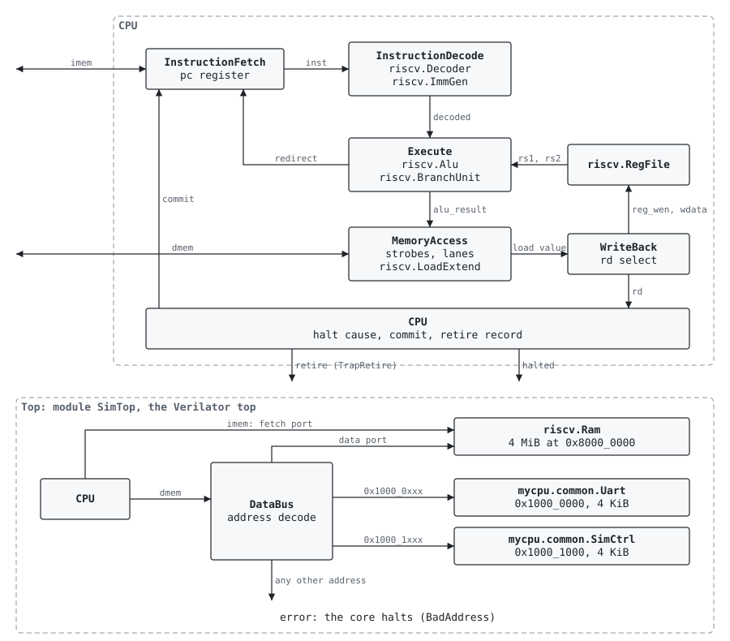

<!-- SPDX-License-Identifier: MIT -->
# T1: Single-Cycle RISC-V CPU

A single-cycle RV32I_Zifencei processor: every instruction is fetched, decoded, executed and
retired within one clock period. It is the first of five tasks. The later tasks add the M
extension (T2), CSRs and traps (T3), a pipeline (T4) and an AXI4-Lite SoC (T5) to the same design.

## Goals

After this task you can:

- build a complete datapath out of the modules you wrote in chisel-bootcamp Module 5 (ALU, decode
  table, branch comparator, load extension) instead of rewriting them;
- explain what limits a single-cycle design (the clock period covers the slowest instruction, so
  CPI is 1 but the clock is slow);
- drive a byte-strobed memory port, and decode a memory map with RAM and memory-mapped devices;
- report every retired instruction on a retire port, and use co-simulation against a golden
  model to find the first instruction at which your core goes wrong;
- run C programs and benchmarks on a Verilator model of your core, and read their cycle and
  instruction counts.

### Key Characteristics

- Execution model: one instruction per clock cycle (an instruction waits only for a device that
  does not answer at once: a store to the UART's `TXDATA` while its transmit FIFO is full)
- Instruction set: RV32I (40 instructions) and Zifencei (`fence.i`)
- No traps yet: `ecall`, `ebreak`, an illegal word, a misaligned access and an unmapped address
  **halt** the core with a cause (they become traps in T3)
- Implementation: Chisel 7, on top of your chisel-bootcamp `riscv` package
- Verification: ChiselSim specs, riscv-tests `rv32ui`, co-simulation against the golden model
  `mycpu.common.Iss`, and the program oracle rv32emu v1.3
- Simulation: one Verilator model (`build/t1/Vsim`), which loads any ELF file

## Block Diagram



The diagram is drawn from [`doc/block-diagram.dg`](doc/block-diagram.dg) by `make diagrams` at the top
of the repository; `make check-diagrams` fails when the two differ.

All of it is combinational except four pieces of state: the PC, the register file, the RAM and
the `halted` flag (plus the devices' own registers).

## Supported Instruction Set

### Arithmetic and Logic Operations

Register operations (10): `add`, `sub`, `slt`, `sltu`, `and`, `or`, `xor`, `sll`, `srl`, `sra`

Immediate operations (9): `addi`, `slti`, `sltiu`, `andi`, `ori`, `xori`, `slli`, `srli`, `srai`

### Memory Access Operations

Loads with sign or zero extension (5): `lb`, `lh`, `lw`, `lbu`, `lhu`

Stores with byte strobes (3): `sb`, `sh`, `sw`

Loads and stores must be aligned to their size. A misaligned access halts the core.

### Control Flow Operations

Branches (6): `beq`, `bne`, `blt`, `bge`, `bltu`, `bgeu`

Jumps (2): `jal`, `jalr`

Upper immediates (2): `lui`, `auipc`

### System and Fence Instructions

`fence` and `fence.i` are no-ops: there is one hart, no cache, and the RAM answers a fetch
combinationally, so a stored instruction is visible to the very next fetch.

`ecall` and `ebreak` halt the core (causes `Ecall` and `Ebreak`). Programs end by writing their
exit code to SimCtrl `EXIT`; riscv-tests end with `ecall` and their verdict in `a0`.

## Execution Stages

The stages are separate modules, all evaluated in the same cycle.

### 1. Instruction Fetch (IF)
> File: `src/main/scala/mycpu/singlecycle/InstructionFetch.scala`

Holds the PC, requests the word at the PC from the instruction port, and chooses the next PC. The
PC moves only when the current instruction commits. A fetch from an address outside the RAM
reports a fetch fault, and the instruction word is then 0.

### 2. Instruction Decode (ID)
> File: `src/main/scala/mycpu/singlecycle/InstructionDecode.scala`

Feeds the instruction to your bootcamp decode table (`riscv.Decoder`) and immediate generator,
and turns the result into a `DecodedInst`: register numbers, immediate, ALU controls, one flag per
kind of instruction, and what the instruction does with `rd`. It also adds `fence.i`, which the
bootcamp's RV32I table does not know.

### 3. Execute (EX)
> File: `src/main/scala/mycpu/singlecycle/Execute.scala`

Runs the ALU (your `riscv.Alu`) on the operands the decode table selects, so one adder computes
results, load and store addresses and branch and jump targets. The bootcamp `BranchUnit` compares
the two source registers. Execute reports whether control transfers and where to (`redirect`),
or that the target is not the address of an instruction, in which case nothing is redirected.

### 4. Memory Access (MEM)
> File: `src/main/scala/mycpu/singlecycle/MemoryAccess.scala`

Turns a load or store into a request on the data port: a word-aligned address, and for each of
the four byte lanes whether a store writes it and with which byte. It checks alignment, waits for the answer, extends loaded data
(`riscv.LoadExtend`) and reports what the access moved for the retire record.

### 5. Write-Back (WB)
> File: `src/main/scala/mycpu/singlecycle/WriteBack.scala`

Selects the value for `rd` (ALU result, loaded data or link address) and decides whether a
register really changes in this cycle.

### The core and the system
> Files: `CPU.scala`, `DataBus.scala`, `Top.scala`

`CPU` connects the stages and the register file, collects each stage's reason to halt the core
and takes the first, and fills the retire record. `DataBus` routes the data port to the RAM, the
UART or SimCtrl by address. `Top` is the system that the Verilator harness and the specs drive.

## What Is Reused from chisel-bootcamp

This task builds on **your own** bootcamp Module 5 code (`make check-bootcamp` must pass before
`make test` or `make sim` run). Nothing below is reimplemented here.

| Bootcamp symbol (`package riscv`) | Notebook | Used in |
|-----------------------------------|----------|---------|
| `Alu`, `AluOp` | 5.2 | `Execute` |
| `RegFile` | 5.2 | `CPU` |
| `Decoder`, `DecodeRows.table`, `Kind`, `ASel`, `BSel`, `ImmGen` | 5.3 | `InstructionDecode`, `Execute` |
| `BranchUnit` | 5.4 | `Execute` |
| `LoadExtend` | 5.4 | `MemoryAccess` |
| `HaltCause` | 5.4 | `CPU`, retire record |
| `Ram`, `MemPort`, `MemReq`, `MemResp`, `LoadPort` | 5.4 | `Top`, every memory interface |
| `UartTx` | 5.8 | `mycpu.common.Uart` |
| `Asm`, `Rv32i`, `IsaSim`, `RandomProgram`, riscv-tests `rv32ui` | 5.1, 5.5 | specs and the golden model |

A mistake in one of your bootcamp modules shows up here as a failing spec. Fix it in the
bootcamp clone; `make check-bootcamp` then runs the bootcamp's own tests again.

## CA26: Exercises

Ten exercises, each marked `[CA26: Exercise 1.<n>]` in the source. A blank is a Scala `?`, which
does not compile (`not found: value ?`) until you replace it. `EXERCISES.md` at the top of the
repository lists the file and line of every blank.

<!-- table: exercises 1 -->
| ID | Title | File | Blanks |
|----|-------|------|--------|
| 1.1 | Next-PC selection and PC update | `InstructionFetch.scala` | 1 |
| 1.2 | Zifencei, and words the bootcamp decoder does not know | `InstructionDecode.scala` | 3 |
| 1.3 | What an instruction does with rd | `InstructionDecode.scala` | 1 |
| 1.4 | Control transfers: the redirect, and a target that is no instruction address | `Execute.scala` | 1 |
| 1.5 | Alignment, and the byte lanes of a store | `MemoryAccess.scala` | 1 |
| 1.6 | Sending the request, waiting for the answer, and what the access moved | `MemoryAccess.scala` | 4 |
| 1.7 | Address decode: device select, the answer, and unmapped addresses | `DataBus.scala` | 1 |
| 1.8 | The write-back value, and when a register really changes | `WriteBack.scala` | 2 |
| 1.9 | The halt causes, stage by stage | `CPU.scala` | 1 |
| 1.10 | The retire record of an instruction that completes | `CPU.scala` | 1 |
<!-- end table -->

Each exercise comment states a contract (what must hold) and cites the bootcamp notebook or the
handout section that explains the idea. It does not state the answer.

### Workflow

1. Read the contract and the module's header comment. Open the cited notebook.
2. Fill the blanks. A blank does not compile, and sbt compiles a task as a whole, so no spec runs
   while one is left. Then run each module's own spec, for example
   `sbt "singleCycle/testOnly mycpu.singlecycle.T1FetchSpec"` (sbt runs at the top of the
   repository, where `build.sbt` is, not in this directory).
3. When the module specs pass, run `make test`. A co-simulation failure prints the first
   instruction where your core and the golden model differ, with both records and the
   instructions before it.
4. Look at the waveform of that instruction: `make sim ELF=<file> SIM_ARGS="+trace=t1.fst"`.

## Commands

Run these in `1-single-cycle/`.

```shell
make test                 # every ChiselSim spec (builds the C programs first)
make test SEEDS=50        # the same with 50 random programs instead of 500
make cosim-random         # the random programs alone (SEEDS=<n>, from seed SEED_FIRST=<first>)
make test-riscv-tests     # riscv-tests rv32ui only
make verilator            # emit SimTop.sv and build build/t1/Vsim
make sim ELF=../build/sw/mycpu/rv32i/fibonacci.elf
make sim ELF=<file> SIM_ARGS="+retire-log=retire.log +trace=t1.fst +trace-start=1000"
make test-programs        # every user program of MANIFEST against its expected output and exit code
make check-rv32emu        # the same programs on rv32emu v1.3 and on your core: same output, exit code, a0
make check-uart           # the uart program echoes its input through +uart-stdin
make cosim-programs       # whole C programs, instruction by instruction against the golden model
make bench                # Dhrystone, DureMark, QR encoder (two builds) -> ../build/bench/t1.csv
make lint                 # verilator --lint-only -Wall on SimTop.sv: zero warnings
make indent               # scalafmt
make clean
```

Parameters:

| Variable | Default | Meaning |
|----------|---------|---------|
| `ELF` | `fibonacci.elf` | program for `make sim` |
| `SIM_ARGS` | empty | extra harness arguments (`+retire-log=`, `+uart-log=`, `+trace=`, `+trace-start=`, `+uart-stdin`) |
| `MAX_CYCLES` | 500000000 | the harness stops with exit code 124 after this many cycles |
| `UART_DIVIDER` | 16 | UART clock cycles per bit (an elaboration parameter of the model) |
| `RAM_BYTES` | 4 MiB | RAM size, a power of two (an elaboration parameter of the model) |
| `SEEDS` | 500 | random programs in `CoSimSpec` (a positive number) |
| `UART_ARGS` | empty | extra harness arguments for `check-uart` (`+uart-no-flow-control` makes it fail) |
| `MUTANT` | empty | `sra`, `unsigned-cmp`, `lui-bit31`, `load-unsigned` or `store-word` builds the core with a known bug (in `build/t1-<name>/` for the Verilator model); `test-riscv-tests` must then fail |
| `BOOTCAMP_DIR` | `externals/chisel-bootcamp` | your bootcamp clone; a relative path is relative to the repository's root |

The model is emitted again when one of its parameters (`UART_DIVIDER`, `RAM_BYTES`, `MUTANT`),
a source of this task, of `common/` or of your bootcamp clone, or the build definition changes.
The bootcamp gate (`make check-bootcamp`) runs again when a file of the clone's `riscv` project
changes.

Harness exit codes: the program's own code (0 to 63), 64 + cause when the core halts (65 `ecall`,
66 `ebreak`, 67 illegal instruction, 68 misaligned, 69 bad address), 124 on a timeout, 2 for a
bad ELF file, 3 for a failed assertion.

## Test Suite

`make test` runs 14 specs with 54 tests:

| Spec | Tests | What it checks |
|------|-------|----------------|
| `T1FetchSpec` | 6 | PC reset, hold, sequential and redirected updates, fetch faults, the reset PC's alignment |
| `T1DecodeSpec` | 4 | every RV32I instruction (random instances), `fence.i`, thousands of illegal words |
| `T1ExecuteSpec` | 6 | ALU results against the ISA model, every branch, jump targets, misaligned targets (no redirect), the `sra` mutant |
| `T1MemoryAccessSpec` | 5 | strobes and lanes for every size and offset, loads, misalignment, held requests, faults, `WriteBack` |
| `T1CpuSpec` | 4 | the core's own ports: no request for an instruction that halts or in reset, a held request retires once |
| `T1RamSpec` | 3 | all 16 strobe patterns across the 4 MiB RAM, no aliasing, errors outside it |
| `DecodeMapSpec` | 5 | `DataBus` routing, unmapped addresses, the three regions from a program |
| `T1UartSpec` | 1 | stores to `TXDATA` with a full FIFO: the core waits, every byte is sent once |
| `HaltSpec` | 7 | one or more directed programs per halt cause, cause priority, reset |
| `FenceISpec` | 3 | stored instructions run after `fence.i`, self-modifying loop |
| `CoSimSpec` | 3 | assembly and C programs and 500 random programs against the golden model |
| `RiscvTestsSpec` | 1 | 40 `rv32ui` tests against the golden model, `a0` = 0 |
| `MutantSpec` | 2 | the `sra` mutant fails `lui`, `sra` and `srai`; the reference passes them |
| `ObsSpec` | 4 | each probe of the observation interface equals the signal it names, cycle by cycle ([docs/observation.md](../docs/observation.md)) |

```shell
make test
# Expected:
# [info] Tests: succeeded 54, failed 0, canceled 0, ignored 0, pending 0
# [info] All tests passed.
```

A missing ELF file is an error that names the command to build it; no spec skips silently.

## Expected Results

Measured on the reference implementation with Verilator 5.054 and xPack GCC 15.2.0
(`-march=rv32i -O2`). Simulation is cycle-exact, so your numbers must be **identical**, not close.
They are those of the default configuration, which the tree builds without a `student.json` (or with
`STUDENT_JSON=`); with yours ([student-config.md](../docs/student-config.md)) the counts that its
options touch differ, and your report quotes your own.

### riscv-tests

`make test-riscv-tests`: **40 of 40** `rv32ui` tests pass. The bootcamp excludes `fence_i`
(Zifencei has its own directed test here, `FenceISpec`) and `ma_data` (misaligned accesses halt).
ACT4 starts at T3, because its test environment needs CSRs.

`make test-riscv-tests MUTANT=sra` must **fail** (3 of 40 fail: `lui`, `sra`, `srai`). It shows
that the test harness can fail. So do `make test-programs MUTANT=sra`, `check-rv32emu` and
`cosim-programs` with it (`quicksort`, `sb`, `strings` and `muldiv` shift negative numbers).

### Programs (`make test-programs`, `make check-rv32emu`)

| Program | Exit code | Cycles | Instructions retired |
|---------|-----------|--------|----------------------|
| `add` | 0 | 570 | 570 |
| `lw` | 0 | 355 | 355 |
| `beq` | 0 | 211 | 211 |
| `fibonacci` | 0 | 2554443 | 2554443 |
| `quicksort` | 0 | 31237 | 31237 |
| `sb` | 0 | 22097 | 22097 |
| `strings` | 0 | 33624 | 33624 |
| `muldiv` | 0 | 578296 | 578296 |
| `jit` | 42 | 932 | 932 |
| `qrcode` | 0 | 5569372 | 5569372 |
| `dhrystone` | 0 | 276699 | 276699 |
| `duremark` | 0 | 1940413 | 1940413 |

All 12 programs print the expected text, and the same text as rv32emu v1.3 (lines that start with
`perf:` are left out of the comparison: they hold platform-dependent counts). `check-rv32emu`
also compares `a0` at exit, from rv32emu's register dump, with what the model shows of it: the
byte the program writes to SimCtrl `EXIT` (the register has only bits [7:0]), which is the
harness's exit code. `muldiv` uses libgcc's software multiply and divide until T2.

### The UART (`make check-uart`)

The `uart` program echoes its input until it reads Ctrl-D. The check sends it 62 bytes through
`+uart-stdin`, once with the console on SimCtrl `PUTC` and once with the console on the UART too
(`CONSOLE_UART=1`). In the second run the program is busy sending its banner while input arrives,
so the 8-byte receive FIFO fills and the harness must wait for `io_uartRxReady`. What the UART
sent is compared byte for byte, from the harness's `+uart-log`:

```
PASS uart (console on the UART): 62 bytes echoed in order, cycles=16734 instret=16734
PASS uart (console on PUTC): 62 bytes echoed in order, cycles=11791 instret=11791
```

`make check-uart UART_ARGS=+uart-no-flow-control` fails: the receiver overruns and input is lost.

### Whole programs against the golden model (`make cosim-programs`)

`CoSimSpec` compares a few thousand instructions per second, so it runs `quicksort`, `sb` and
`strings` to their end and only the first 50000 instructions of `fibonacci`.
`make cosim-programs` compares whole runs instead: the model writes a `+retire-log`, and
`RetireLogCheck` replays it against the golden model (`mycpu.common.RetireLog` and
`CoSim2.replay`), in the cycles and with the exit code that the log gives.

```
PASS fibonacci: 2554443 records in 2554443 cycles (0 without a record) agree with the golden model, exit 0
PASS quicksort: 31237 records in 31237 cycles (0 without a record) agree with the golden model, exit 0
PASS sb: 22097 records in 22097 cycles (0 without a record) agree with the golden model, exit 0
PASS strings: 33624 records in 33624 cycles (0 without a record) agree with the golden model, exit 0
PASS jit: 932 records in 932 cycles (0 without a record) agree with the golden model, exit 42
```

`COSIM_PROGRAMS="muldiv dhrystone duremark qrcode"` checks the other four the same way (the
logs need about 110 bytes per instruction while the check runs). A cycle in which nothing
retires is in the log too (the `idle` lines, see below), so the replay follows a core that waits:
this one behind a full UART, and the core of T2, whose divider takes 34 cycles
(`2-rv32im/README.md`).

### Benchmarks (`make bench`)

`../build/bench/t1.csv`:

<!-- table: bench t1 columns=cycles,instret,cpi,score,score_unit -->
| variant | arch | benchmark | cycles | instret | cpi | score | score_unit |
|---------|------|-----------|--------|---------|-----|-------|------------|
| single-cycle | rv32i | dhrystone | 244583 | 244582 | 1.000 | 1163 | DMIPS/MHz*1000 |
| single-cycle | rv32i | duremark | 1909742 | 1909844 | 1.000 | 10472 | DureMark/MHz*1000 |
| single-cycle | rv32i | qrcode-table-L | 1071315 | 1071306 | 1.000 | - | - |
| single-cycle | rv32i | qrcode-table-M | 1061134 | 1061125 | 1.000 | - | - |
| single-cycle | rv32i | qrcode-table-Q | 1455952 | 1455943 | 1.000 | - | - |
| single-cycle | rv32i | qrcode-table-H | 1881639 | 1881630 | 1.000 | - | - |
| single-cycle | rv32i | qrcode-bitwise-L | 1136205 | 1136196 | 1.000 | - | - |
| single-cycle | rv32i | qrcode-bitwise-M | 1170105 | 1170096 | 1.000 | - | - |
| single-cycle | rv32i | qrcode-bitwise-Q | 1576484 | 1576475 | 1.000 | - | - |
| single-cycle | rv32i | qrcode-bitwise-H | 1972512 | 1972503 | 1.000 | - | - |
<!-- end table -->

The QR encoder runs in two builds: GF(2^8) multiplication by table (`QR_GF=table`, the default)
and bit by bit (`QR_GF=bitwise`). The script fails, and writes no file, unless all 10 workloads
print their counts exactly once and every run exits with 0.

These counts are the programs' own, read from SimCtrl `CYCLE` and `INSTRET` around the measured
code (T1 has no counter CSRs). **CPI is exactly 1**: the harness reports `cycles` equal to
`instret` for every whole run (the table under Programs), and the two `mark` lines of a
`+retire-log` are the same number of cycles and of instructions apart (244666 for Dhrystone).
The small differences in this table come from how each program reads its counters, not from
the core:

- Dhrystone reads `CYCLE` and then `INSTRET`, at the start and at the end. The code between the
  two reads is 40 instructions long at the start and 39 at the end, so the instruction window is
  one instruction shorter.
- DureMark's `Cycles` is the sum over its three workloads, each timed on its own, while its
  `Instret` is counted once around all of them. The two cover different stretches of code:
  `Instret` includes the 102 instructions between the timed sections, so it is larger than
  `Cycles` although no cycle retires more than one instruction.
- The QR encoder reads `CYCLE` outside its two `INSTRET` reads, which adds 9 cycles.

Dhrystone 1.1 numbers are not comparable with published Dhrystone 2.1 numbers. A CPI of 1 says
nothing about speed: the clock period of this design must cover fetch, decode, the ALU, a memory
access and write-back in a row. T4 trades CPI for clock period.

### Lint

`make lint` prints no warning. The only waivers are those in `sim/lint.vlt`, for names that
firtool generates.

## Simulation with Verilator

```shell
make verilator
make sim ELF=../build/sw/mycpu/rv32i/quicksort.elf
# n=200 min=-8376441 max=8366059
# sorted=1 checksum=0xbbb77bac
# cycles=31237 instret=31237
```

The harness loads every `PT_LOAD` segment of the ELF file through the RAM's load port while it
holds reset, so one model runs every program. Console output written to SimCtrl `PUTC` or to the
UART appears on stdout; the last line (on stderr) is the harness's own count.

`+retire-log=<file>` writes one line per retired instruction, an `idle <n>` line for `n`
cycles in a row without one (this core has them only while the UART holds a write), a `mark`
line at each write to SimCtrl `MARK`, and a last line that says how the run ended:

```
pc=800023ac inst=00e7ac23 next=800023b0 rd=0 val=00000000 mem=w:10001018:4:00000001 csr=- trap=- halt=0 mip=-
mark cycle=11030 instret=11030
end cycles=276699 instret=276699 exit=0
```

`+uart-log=<file>` writes the bytes that the UART sent to a file of their own (stdout has them
together with the bytes of SimCtrl `PUTC`).

`+trace=<file.fst>` writes a waveform for GTKWave or Surfer; `+trace-start=<cycle>` keeps it
small.

## What You Submit

One HackMD note for this task, in the format of the course handout's submission note, with:

1. **Test logs**, as the commands printed them: the summary lines of `make test` (`Tests:
   succeeded ...`), and the output of `make test-riscv-tests` (and of `make test-riscv-tests
   MUTANT=sra`, which must fail), `make test-programs`, `make check-rv32emu`, `make check-uart` and
   `make cosim-programs`. T1 has no ACT4 run: its test environment needs CSRs, which arrive in T3.
2. **The benchmark report**: `../build/bench/t1.csv` from `make bench`.
3. **Your bootcamp answers**: `../build/bootcamp.patch` from `make bootcamp-patch` at the top of
   the repository (this task builds on them).
4. **Two exercises explained**, at least, with **your own** waveform screenshots or `+retire-log`
   excerpts, walked through cycle by cycle. For example: show the cycle in which a taken branch
   retires and explain the values of `redirect`, `next_pc` and `commit` in it (1.1, 1.4); or a
   store of a byte to an odd address and its lanes and strobes (1.5).
5. **Answers to the three questions below.** Each needs a run with a parameter **you** choose:
   state the parameter, the command lines and the numbers you measured.

### Questions

**Q1. The UART as console.** Pick a `UART_DIVIDER` between 4 and 64 that is not 16, and build the
model with it (`make verilator UART_DIVIDER=<n>`; every later `make sim` needs the same
`UART_DIVIDER=<n>`). Build `strings` with the UART as console into a directory of its own (`make -C
../software strings CONSOLE_UART=1 BUILD=../build/uart`), run it (`make sim UART_DIVIDER=<n>
ELF=../build/uart/sw/mycpu/rv32i/strings.elf`) and compare `cycles` and `instret` with the
SimCtrl console build (33624 each). Is `cycles` still equal to `instret` for your divider, that
is, did the core ever wait for the UART? Explain your answer from `software/runtime/uart.c`, and
say where the extra instructions come from. Predict both counts for a second divider of your
choice from your first measurement, then measure them. Finally, describe what a program that
writes `TXDATA` without reading `STATUS` first would change in these two numbers, and which
exercises of this task decide whether it prints every character.

**Q2. A smaller RAM.** Pick a `RAM_BYTES` that is a power of two between 64 KiB and 2 MiB, build
the model with it (`make verilator RAM_BYTES=<n>`) and run `quicksort` on it (`make sim
RAM_BYTES=<n> ELF=../build/sw/mycpu/rv32i/quicksort.elf SIM_ARGS=+retire-log=q2.log`). Report the
harness's exit code and the last line it prints, and explain them from the `+retire-log`: which
instruction is the last record, which address does it use, where does that address come from
(`software/runtime/link.ld`), and which path through `DataBus` and `CPU` turns it into this exit
code? Then give the smallest change outside the RTL that makes the program run on your RAM, and
show that it does.

**Q3. Counting loops.** Build Dhrystone with two `LOOPS` values of your choice (`make -C
../software dhrystone LOOPS=<n> BUILD=../build/loops<n>`) and run each (`make sim
ELF=../build/loops<n>/sw/mycpu/rv32i/dhrystone.elf`). From your two measurements alone, compute
the cycles per loop and the cycles that the measured region spends outside the loop, and compare
with the `perf: cycles/loop` line. Then use `+retire-log` to show, for one of your builds, why
`perf: cycles` and `perf: instret` differ by a constant although every cycle retires one
instruction: find the reads of SimCtrl `CYCLE` and `INSTRET` in the log and count the records
between them.

## File Organization

```
1-single-cycle/
├── Makefile
├── README.md
├── doc/block-diagram.dg     the block diagram's source (make diagrams draws the .svg)
└── src/
    ├── main/scala/mycpu/singlecycle/
    │   ├── InstructionFetch.scala    Exercise 1.1
    │   ├── InstructionDecode.scala   Exercises 1.2, 1.3
    │   ├── Execute.scala             Exercise 1.4
    │   ├── MemoryAccess.scala        Exercises 1.5, 1.6
    │   ├── DataBus.scala             Exercise 1.7
    │   ├── WriteBack.scala           Exercise 1.8
    │   ├── CPU.scala                 Exercises 1.9, 1.10
    │   ├── Probes.scala              the probes of the observation interface (docs/observation.md)
    │   └── Top.scala                 the system (SimTop) and the model emitter
    └── test/scala/mycpu/singlecycle/
        ├── T1.scala                  shared helpers: golden model, ELF files
        ├── T1FetchSpec.scala  T1DecodeSpec.scala  T1ExecuteSpec.scala
        ├── T1MemoryAccessSpec.scala  T1CpuSpec.scala  T1RamSpec.scala
        ├── DecodeMapSpec.scala  T1UartSpec.scala
        ├── HaltSpec.scala  FenceISpec.scala  CoSimSpec.scala
        ├── RiscvTestsSpec.scala  MutantSpec.scala  ObsSpec.scala
        └── RetireLogCheck.scala      replays a +retire-log against the golden model
```

Shared code lives outside this directory: `common/` (SimCtrl, UART, golden model, co-simulation,
ELF and retire-log readers), `sim/` (the Verilator harness) and `software/` (runtime, programs, benchmarks).

## References

- [The RISC-V Instruction Set Manual, Volume I: Unprivileged Architecture](https://riscv.org/specifications/ratified/),
  version 20240411: RV32I and the Zifencei extension
- chisel-bootcamp Module 5: notebooks 5.1 to 5.5 and 5.8, and `riscv/DESIGN.md` (halt causes,
  retire port)
- `common/src/main/scala/mycpu/common/Sim.scala`: the memory map, `TrapRetire` and `SimIO`
- `sim/main.cpp`: harness arguments, exit codes and the retire-log format
