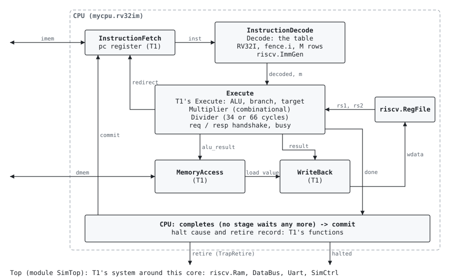

<!-- SPDX-License-Identifier: MIT -->
# T2: RV32IM, a Multiplier and a Divider That Stalls

The single-cycle core of T1 with the M extension: a multiplier that answers within the cycle, and
an iterative divider that takes 34 cycles, so the core must **stall** for the first time. It is
the second of five tasks. The stall you build here is the one that the pipeline of T4 needs for
every hazard.

## Goals

After this task you can:

- extend a decode table with new instructions and new control signals without touching the rows
  that exist (the table is data: `Decode.rv32im`);
- build one signed 33 x 33 multiplier that serves `mul`, `mulh`, `mulhsu` and `mulhu`;
- build a restoring radix-2 divider with a request/response handshake, signed and unsigned, with
  the specification's results for division by zero and for the signed overflow;
- make a core wait for a unit that takes many cycles: hold the PC and all architectural state,
  retire the instruction in the cycle of the response, and repeat no side effect;
- write the golden model of an extension from the specification, and use it to check hardware
  that was written from the same text in another shape;
- explain a CPI above 1 exactly, cycle for cycle, from the retire log.

### Key Characteristics

- Execution model: one instruction per clock cycle, except a division: `DIV_LATENCY` = 34 cycles
  after it is issued (66 with the two-cycle-per-bit divider), or 1 cycle for a division by zero
  and for `MIN / -1`. As in T1, a store to a full UART also waits.
- Instruction set: RV32I (40 instructions), Zifencei (`fence.i`) and M (8 instructions)
- No traps yet: the halt causes are T1's. M adds none.
- Implementation: T1's stages (with your own answers in them), plus this task's decode table,
  multiplier, divider, decode and execute stages
- Verification: ChiselSim specs, riscv-tests `rv32ui` and `rv32um`, co-simulation against the
  golden model `mycpu.common.Iss` with `mycpu.rv32im.IssM`, and the program oracle rv32emu v1.3
- Simulation: one Verilator model per divider latency (`build/t2/Vsim`, `build/t2-div66/Vsim`)

## Block Diagram



The diagram is drawn from [`doc/block-diagram.dg`](doc/block-diagram.dg) by `make diagrams` at the top
of the repository; `make check-diagrams` fails when the two differ.

The state is T1's (the PC, the register file, the RAM, the `halted` flag and the devices) plus
the divider's registers. While the divider is busy, the core's own state holds: the PC, the
register file, the RAM and `halted`. The devices run on by themselves: SimCtrl `CYCLE` counts,
and a UART frame that is on the line is sent to its end.

## What M Adds

### Multiplication (4): `mul`, `mulh`, `mulhsu`, `mulhu`

One signed multiplier of 33 x 33 bits: each operand gets a 33rd bit that makes it, read as a
signed number, the value the instruction gives it. The product is formed within the cycle, so a
multiplication takes no extra cycle, and is one of the longest paths of the design.

### Division (4): `div`, `divu`, `rem`, `remu`

A restoring divider that finds one quotient bit per iteration on the magnitudes of the operands:
1 setup cycle, 32 iterations, 1 cycle that fixes the sign. `Divider.scala` describes the
handshake, the latency and `kill` exactly; read its header before you write the stall.

| Request | Cycles from request to response |
|---------|---------------------------------|
| any other division, `DIV_LATENCY=34` | 34 |
| any other division, `DIV_LATENCY=66` (two cycles per bit) | 66 |
| division by zero | 1 |
| signed overflow (the most negative number divided by -1; `div` and `rem` only) | 1 |

The specification gives the results of the last two (Unprivileged spec, "M" extension, the table
of the division special cases); the divider answers them without iterating.

### The stall

A division is issued in the first cycle in which it is at the PC, and retires in the cycle of
the divider's response. In between:

- the PC holds, so the same instruction is fetched and decoded in every cycle;
- no register is written, and nothing is on the retire port;
- the data port carries no request (a division has no access, and the instruction after it has
  not been fetched), so no store and no device access happens early or twice;
- SimCtrl `CYCLE` counts every cycle, `INSTRET` only the record at the end.

A division whose result nobody reads (`rd` is `x0`) is carried out like any other: the core does
not look at `rd` to decide whether to wait. The divider's `kill` input is tied low here, because
this core never abandons an instruction it has started. The later cores use it: one that takes
an interrupt (T3 on) must decide what happens to a division in progress, and the pipeline of T4
connects `kill` to the flush of the stage that holds the division (T4-04).

## Stages and Files

### Reused from T1 (`mycpu.singlecycle`, with your own answers)

| T1 unit | Used as | Why it is unchanged |
|---------|---------|---------------------|
| `InstructionFetch` | the fetch stage | the PC moves on `commit`, whatever makes an instruction wait |
| `Execute` | inside this task's `Execute` | the ALU and the control-transfer decision do not change |
| `MemoryAccess` | the memory stage | loads and stores do not change |
| `WriteBack` | the write-back stage | an M result reaches it as the execute stage's value |
| `CPU.haltCause`, `CPU.retireRecord` | the halt cause and the retire record | the causes and the record do not change |
| `DecodedInst`, `RdSource` | what the stages above read | |
| `DataBus` | the address decode of `Top` | the memory map does not change |

`build.sbt` makes `rv32im` depend on `singleCycle`, so a mistake in a T1 answer shows up here
too. Nothing from T1 is copied into this directory.

### New in this task (`mycpu.rv32im`)

| File | What it is |
|------|------------|
| `Decode.scala` | the decode table: RV32I rows from your bootcamp table, `fence.i`, the 8 M rows |
| `Multiplier.scala` | the 33 x 33 multiplier (combinational) |
| `Divider.scala` | the iterative divider, both latency options |
| `InstructionDecode.scala` | the decode stage: the table's output in the shape T1's stages read, and what M adds |
| `Execute.scala` | the execute stage: T1's, the multiplier, the divider, the result select and `done` |
| `CPU.scala` | the core: the stages, and when an instruction completes |
| `Top.scala` | the system (`SimTop`) and the model emitter (`divLatency=<34\|66>`) |
| `IssM.scala` | the M extension of the golden model |

T1's `InstructionDecode` and `Top` modules are not used: the first is replaced by the table, the
second by a `Top` with this core (which takes T1's default UART divider).

### The golden model

`mycpu.common.Iss` decodes the M instructions but does not know what they compute: that is
`IssM.mulDiv`, which this task supplies through `IssConfig.mulDiv` (`IssM.T2` is the
configuration of this task). A model with M and without `IssM` throws at the first M
instruction it executes, so T1 does not need this task to build.

## CA26: Exercises

Seven exercises, each marked `[CA26: Exercise 2.<n>]` in the source: six with blanks, and one
(2.6) to find a bug in. A blank is a Scala `?`, which does not compile until you replace it.
`EXERCISES.md` at the top of the repository lists the file and line of every blank.

A find-the-bug exercise has no blank: its code is given, compiles, and breaks the rule its header
states in one place. Find the bug with the specs, a retire log or a waveform, fix it, and explain
the fix in your report: which run showed it, in which cycle and signal, and why the fix is right.

The golden model of M (`IssM.scala`) is given: it is written from the specification and
independently of your hardware, so that a mistake of your multiplier or divider shows up as a
co-simulation mismatch instead of being repeated in its model. Read it as the specification of
M in executable form.

<!-- table: exercises 2 -->
| ID | Title | File | Blanks |
|----|-------|------|--------|
| 2.1 | The rows of the decode table | `Decode.scala` | 4 |
| 2.2 | One signed multiplier for four instructions | `Multiplier.scala` | 2 |
| 2.3 | The iteration step | `Divider.scala` | 1 |
| 2.4 | Special cases and signs | `Divider.scala` | 5 |
| 2.5 | Handshake, state transitions and kill | `Divider.scala` | 1 |
| 2.6 | Find the bug: the stall of an instruction that takes more than one cycle | `CPU.scala` | none: a bug to find |
| 2.7 | The result of the execute stage | `Execute.scala` | 1 |
<!-- end table -->

### Workflow

All blanks of this task are in one sbt project, so nothing compiles until every one is filled.
A workable order:

1. 2.1 and 2.2 first (tables and arithmetic). Then 2.3 to 2.5; a first version of the divider
   may answer in the wrong cycle and still let everything compile. Then 2.7, so that the project
   compiles; 2.6 compiles as it is given, and its bug shows in the specs of step 3.
2. Run the unit specs, at the top of the repository as in T1:
   `sbt "rv32im/testOnly mycpu.rv32im.MulSpec mycpu.rv32im.DivSpec mycpu.rv32im.IssMSpec"`.
   The specs that check the table of 2.1 on its own are held back (see the Test Suite); a wrong
   row of it shows from step 3 on, in the specs that run programs.
3. Then the specs of 2.6 and 2.7: `sbt "rv32im/testOnly mycpu.rv32im.T2ExecuteSpec mycpu.rv32im.T2CpuSpec
   mycpu.rv32im.StallSpec"`. `T2CpuSpec` names the cycle and the signal that is wrong.
4. `make test`, then the programs. Look at a division in a waveform:
   `make sim SIM_ARGS="+trace=t2.fst"`.

## Commands

Run these in `2-rv32im/`.

```shell
make test                 # every ChiselSim spec (builds the C programs for rv32i and rv32im first)
make test SEEDS=50        # the same with 50 random programs instead of 500
make cosim-random         # the random programs alone (SEEDS=<n>, from seed SEED_FIRST=<first>)
make test-riscv-tests     # riscv-tests rv32ui and rv32um only
make verilator            # emit SimTop.sv and build build/t2/Vsim
make sim ELF=../build/sw/mycpu/rv32im/muldiv.elf
make sim ELF=<file> SIM_ARGS="+retire-log=retire.log +trace=t2.fst +trace-start=1000"
make test-programs        # every user program of MANIFEST against its expected output and exit code
make check-rv32emu        # the same programs on rv32emu v1.3 and on your core: same output, exit code, a0
make check-uart           # the uart program echoes its input through +uart-stdin
make cosim-programs       # all nine C programs, instruction by instruction against the golden model
make bench                # the benchmarks without M, with M, and with the slow divider -> ../build/bench/t2.csv
make lint                 # verilator --lint-only -Wall on SimTop.sv: zero warnings
make indent               # scalafmt
make clean
```

Parameters:

| Variable | Default | Meaning |
|----------|---------|---------|
| `ARCH` | `rv32im` | the build of the C programs: `rv32im` (hardware multiply and divide) or `rv32i` (libgcc) |
| `DIV_LATENCY` | 34 | the divider: 34, or 66 (two cycles per bit); each has its own model directory |
| `ELF` | `muldiv.elf` | program for `make sim` |
| `SIM_ARGS` | empty | extra harness arguments (`+retire-log=`, `+uart-log=`, `+trace=`, `+trace-start=`, `+uart-stdin`) |
| `MAX_CYCLES` | 500000000 | the harness stops with exit code 124 after this many cycles |
| `UART_DIVIDER` | 16 | UART clock cycles per bit (an elaboration parameter of the model) |
| `RAM_BYTES` | 4 MiB | RAM size, a power of two (an elaboration parameter of the model) |
| `SEEDS` | 500 | random programs in `CoSimSpec` (a positive number) |
| `MUTANT` | empty | `sra`, `no-sign-fix`, `mulh-unsigned` or `no-div-stall` builds the core with a known bug; `test-riscv-tests` must then fail |
| `BENCH_CONFIGS` | `34/rv32i 34/rv32im 66/rv32im` | the `<DIV_LATENCY>/<ARCH>` pairs that `make bench` runs |
| `BOOTCAMP_DIR` | `externals/chisel-bootcamp` | your bootcamp clone; a relative path is relative to the repository's root |

The model is emitted again when one of its parameters (`DIV_LATENCY`, `UART_DIVIDER`,
`RAM_BYTES`, `MUTANT`), a source of this task, of T1, of `common/` or of your bootcamp clone, or
the build definition changes. `ARCH` selects programs, not a model: both builds run on the same
RV32IM core.

## Test Suite

`make test` runs 14 specs with 67 tests:

| Spec | Tests | What it checks |
|------|-------|----------------|
| `MModelSpec` | 3 | the specs' own model of M against results worked out by hand |
| `MulSpec` | 3 | the multiplier on corner pairs and 10 000 random pairs |
| `DivSpec` | 18 | the divider: results, latency, the special cases, `kill` in every cycle, for both latencies |
| `DivMutantSpec` | 4 | the `no-sign-fix` divider fails exactly where the sign matters |
| `LeafLintSpec` | 5 | the leaf units pass `verilator --lint-only -Wall` |
| `IssMSpec` | 5 | `IssM.mulDiv` against the model; `Iss` with M on `rv32um`, random programs and rv32emu |
| `T2ExecuteSpec` | 7 | the result select, `done` after exactly the latency, no start without `valid`, the mutants |
| `T2CpuSpec` | 4 | the core's ports in every cycle of a stall: PC, write enable, data port, `busy`, retire |
| `StallSpec` | 5 | directed programs on the system: every record after exactly its latency, devices quiet, UART and divider in turn |
| `T2HaltSpec` | 2 | T1's halt causes right after a division; M instructions are legal |
| `CoSimSpec` | 4 | assembly and C programs (with and without M) and 500 random programs with M against the golden model |
| `RiscvTestsSpec` | 1 | 40 `rv32ui` and 8 `rv32um` tests against the golden model, `a0` = 0 |
| `MutantSpec` | 5 | each mutant (`make list-mutants`) fails at least one `rv32ui` or `rv32um` test, the reference passes them |
| `T2ObsSpec` | 3 | each probe of the observation interface equals the signal it names, the divider included ([docs/observation.md](../docs/observation.md)) |

Two more specs check the table of exercise 2.1 directly: `DecodeMSpec` (10 tests: every
instruction of the listings, every one-bit neighbor, all 128 `funct7` values) and `T2DecodeSpec`
(3 tests: the decode stage says what T1's says for RV32I and gives M to the execute stage). They
are held back: they are not in your tree, and the TAs run them on your submission.

```shell
make test
# Expected:
# [info] Tests: succeeded 67, failed 0, canceled 0, ignored 0, pending 0
# [info] All tests passed.
```

A missing ELF file is an error that names the command to build it; no spec skips silently.

## Expected Results

Measured on the reference implementation with Verilator 5.054 and xPack GCC 15.2.0 (`-O2`).
Simulation is cycle-exact, so your numbers must be **identical**, not close.
### riscv-tests

`make test-riscv-tests`: **40 of 40** `rv32ui` tests and **8 of 8** `rv32um` tests pass. ACT4
starts at T3, because its test environment needs CSRs.

Both mutants must **fail**, which shows that the harness can:

| Command | Fails |
|---------|-------|
| `make test-riscv-tests MUTANT=sra` | 3 of 40 `rv32ui`: `lui`, `sra`, `srai` |
| `make test-riscv-tests MUTANT=no-sign-fix` | 2 of 8 `rv32um`: `div`, `rem` |

### Programs (`make test-programs`, `make check-rv32emu`)

Whole runs, as the harness counts them (`cycles=`, `instret=` on its last line):

| Program | Exit | `rv32i` cycles = instret | `rv32im` cycles | `rv32im` instret | `rv32im`, `DIV_LATENCY=66` cycles |
|---------|------|--------------------------|-----------------|------------------|-----------------------------------|
| `add` | 0 | 570 | 570 | 570 | 570 |
| `lw` | 0 | 355 | 355 | 355 | 355 |
| `beq` | 0 | 211 | 211 | 211 | 211 |
| `fibonacci` | 0 | 2554443 | 2552640 | 2552640 | 2552640 |
| `quicksort` | 0 | 31237 | 26150 | 25606 | 26662 |
| `sb` | 0 | 22097 | 14661 | 10037 | 19013 |
| `strings` | 0 | 33624 | 13602 | 8570 | 18338 |
| `muldiv` | 0 | 578296 | 176920 | 92354 | 256472 |
| `jit` | 42 | 932 | 792 | 792 | 792 |
| `qrcode` | 0 | 5569372 | 3704176 | 3205294 | 4173866 |
| `dhrystone` | 0 | 276699 | 272217 | 270653 | 273689 |
| `duremark` | 0 | 1940413 | 941560 | 938432 | 944504 |

All 12 programs print the expected text, and the same text as rv32emu v1.3, in every one of
these configurations. Built without M, a program executes no M instruction, so the T2 core runs
it exactly as the T1 core does: one cycle per instruction, the same counts as in
`1-single-cycle/README.md`. The assembly programs `add`, `lw` and `beq` use no M instruction.
Built with M, `fibonacci` and `jit` execute no division (their
counts are lower than without M because they multiply). The instruction count of a program does
not depend on the divider, with one exception: `qrcode` retires 3205316 instructions on the
66-cycle model, 22 more, because it prints its own cycle counts and they have more digits.

### The UART (`make check-uart`)

```
PASS uart (console on the UART): 62 bytes echoed in order, cycles=16731 instret=16595
PASS uart (console on PUTC): 62 bytes echoed in order, cycles=11768 instret=11632
```

### Whole programs against the golden model (`make cosim-programs`)

All nine programs are replayed from the model's `+retire-log`. The seven that divide must have
cycles without a record (`--stalls`: a log without one would prove nothing about the stall):

```
PASS quicksort: 25606 records in 26150 cycles (544 without a record) agree with the golden model, exit 0
PASS sb: 10037 records in 14661 cycles (4624 without a record) agree with the golden model, exit 0
PASS strings: 8570 records in 13602 cycles (5032 without a record) agree with the golden model, exit 0
PASS muldiv: 92354 records in 176920 cycles (84566 without a record) agree with the golden model, exit 0
PASS qrcode: 3205294 records in 3704176 cycles (498882 without a record) agree with the golden model, exit 0
PASS dhrystone: 270653 records in 272217 cycles (1564 without a record) agree with the golden model, exit 0
PASS duremark: 938432 records in 941560 cycles (3128 without a record) agree with the golden model, exit 0
PASS fibonacci: 2552640 records in 2552640 cycles (0 without a record) agree with the golden model, exit 0
PASS jit: 792 records in 792 cycles (0 without a record) agree with the golden model, exit 42
```

### Benchmarks (`make bench`)

`../build/bench/t2.csv`, the programs' own counts between their markers:

<!-- table: bench t2 columns=cycles,instret,cpi,score,score_unit -->
| variant | arch | benchmark | cycles | instret | cpi | score | score_unit |
|---------|------|-----------|--------|---------|-----|-------|------------|
| div34 | rv32i | dhrystone | 244583 | 244582 | 1.000 | 1163 | DMIPS/MHz*1000 |
| div34 | rv32i | duremark | 1909742 | 1909844 | 1.000 | 10472 | DureMark/MHz*1000 |
| div34 | rv32i | qrcode-table-L | 1071315 | 1071306 | 1.000 | - | - |
| div34 | rv32i | qrcode-table-M | 1061134 | 1061125 | 1.000 | - | - |
| div34 | rv32i | qrcode-table-Q | 1455952 | 1455943 | 1.000 | - | - |
| div34 | rv32i | qrcode-table-H | 1881639 | 1881630 | 1.000 | - | - |
| div34 | rv32i | qrcode-bitwise-L | 1136205 | 1136196 | 1.000 | - | - |
| div34 | rv32i | qrcode-bitwise-M | 1170105 | 1170096 | 1.000 | - | - |
| div34 | rv32i | qrcode-bitwise-Q | 1576484 | 1576475 | 1.000 | - | - |
| div34 | rv32i | qrcode-bitwise-H | 1972512 | 1972503 | 1.000 | - | - |
| div34 | rv32im | dhrystone | 243083 | 243082 | 1.000 | 1170 | DMIPS/MHz*1000 |
| div34 | rv32im | duremark | 921043 | 921145 | 1.000 | 21714 | DureMark/MHz*1000 |
| div34 | rv32im | qrcode-table-L | 722306 | 630123 | 1.146 | - | - |
| div34 | rv32im | qrcode-table-M | 730274 | 637717 | 1.145 | - | - |
| div34 | rv32im | qrcode-table-Q | 959320 | 825487 | 1.162 | - | - |
| div34 | rv32im | qrcode-table-H | 1200144 | 1023199 | 1.173 | - | - |
| div34 | rv32im | qrcode-bitwise-L | 787187 | 695004 | 1.133 | - | - |
| div34 | rv32im | qrcode-bitwise-M | 839236 | 746679 | 1.124 | - | - |
| div34 | rv32im | qrcode-bitwise-Q | 1079847 | 946014 | 1.141 | - | - |
| div34 | rv32im | qrcode-bitwise-H | 1291021 | 1114076 | 1.159 | - | - |
| div66 | rv32im | dhrystone | 243083 | 243082 | 1.000 | 1170 | DMIPS/MHz*1000 |
| div66 | rv32im | duremark | 921043 | 921145 | 1.000 | 21714 | DureMark/MHz*1000 |
| div66 | rv32im | qrcode-table-L | 809058 | 630123 | 1.284 | - | - |
| div66 | rv32im | qrcode-table-M | 817378 | 637717 | 1.282 | - | - |
| div66 | rv32im | qrcode-table-Q | 1085272 | 825487 | 1.315 | - | - |
| div66 | rv32im | qrcode-table-H | 1366672 | 1023199 | 1.336 | - | - |
| div66 | rv32im | qrcode-bitwise-L | 873939 | 695004 | 1.257 | - | - |
| div66 | rv32im | qrcode-bitwise-M | 926340 | 746679 | 1.241 | - | - |
| div66 | rv32im | qrcode-bitwise-Q | 1205799 | 946014 | 1.275 | - | - |
| div66 | rv32im | qrcode-bitwise-H | 1457549 | 1114076 | 1.308 | - | - |
<!-- end table -->

Built for `rv32i`, every row has CPI 1.000 and the numbers of T1.

**libgcc against hardware M.**

- DureMark runs 2.07 times faster in cycles, and retires half the instructions (921145 against
  1909844): where the `rv32i` build calls libgcc's `__mulsi3`, a loop of instructions, the
  `rv32im` build has one `mul`, which takes one cycle. Its score doubles.
- The QR encoder runs 1.39 to 1.57 times faster, although it now waits for the divider in 11 %
  to 15 % of its cycles (CPI 1.124 to 1.173): it gains more from the multiplier than the stall
  costs. With the 66-cycle divider it is still faster than the `rv32i` build in every row.
- Dhrystone gains almost nothing (1.006 times). Its timed loop executes no division: the two
  `mark` lines of its `+retire-log` are 243166 cycles and 243166 instructions apart. All 46
  divisions of the run are outside the markers, where the results are printed.

### Where CPI above 1 comes from

In this core a cycle either retires an instruction or waits for the divider (the programs here
poll the UART, so they never wait for it). Therefore, exactly:

```
cycles - instret = DIV_LATENCY x (divisions) + 1 x (divisions by zero and signed overflows)
```

The `+retire-log` shows it: an `idle <n>` line stands for `n` cycles without a record, and each
one is followed by the record of the division that the core waited for.

```
pc=80001250 inst=02058c63 next=80001288 rd=0 val=00000000 mem=- csr=- trap=- halt=0 mip=-
idle 34
pc=80001288 inst=033577b3 next=8000128c rd=15 val=00000003 mem=- csr=- trap=- halt=0 mip=-
```

| Run (`rv32im`) | cycles | instret | cycles - instret | `idle` lines | sum of the `idle` lines |
|----------------|--------|---------|------------------|--------------|-------------------------|
| `dhrystone`, 34 | 272217 | 270653 | 1564 | 46 of 34 | 46 x 34 = 1564 |
| `dhrystone`, 66 | 273689 | 270653 | 3036 | 46 of 66 | 46 x 66 = 3036 |
| `muldiv`, 34 | 176920 | 92354 | 84566 | 2486 of 34, 42 of 1 | 2486 x 34 + 42 = 84566 |
| `muldiv`, 66 | 256472 | 92354 | 164118 | 2486 of 66, 42 of 1 | 2486 x 66 + 42 = 164118 |

Every `idle` line is directly before a `div`, `divu`, `rem` or `remu` record, and every such
record has one: 46 divisions in `dhrystone`, 2528 in `muldiv`, of which 42 are the special
cases (`muldiv` divides by zero and `MIN` by -1 on purpose). `make cosim-programs` checks the
same thing from the other side: the golden model accepts the records in exactly these cycles.
The instruction count of these two programs does not depend on the latency, and the cycle count
grows by 32 per division from 34 to 66.

The CPI of a whole run follows: 1.006 for `dhrystone`, 1.916 for `muldiv`, and 2.777 for
`muldiv` with the slow divider.

### Lint

`make lint` and `make lint DIV_LATENCY=66` print no warning. The only waivers are those in
`sim/lint.vlt`.

## Simulation with Verilator

```shell
make verilator
make sim ELF=../build/sw/mycpu/rv32im/quicksort.elf
# n=200 min=-8376441 max=8366059
# sorted=1 checksum=0xbbb77bac
# cycles=26150 instret=25606
```

The harness and its arguments are T1's (`1-single-cycle/README.md`, "Simulation with
Verilator"). In a waveform (`+trace=t2.fst`), look at `cpu.execute.divider`: `state`, `count`,
`io_req_valid`, `io_req_ready`, `io_resp_valid` and `io_busy`, next to `cpu.fetch.pc` and
`cpu.regs.io_wen`.

## What You Submit

One HackMD note for this task, in the format of the course handout's submission note, with:

1. **Test logs**, as the commands printed them: the summary lines of `make test`, and the output
   of `make test-riscv-tests` (and of both `MUTANT` runs, which must fail), `make test-programs`,
   `make check-rv32emu`, `make cosim-programs` and `make check-uart`. ACT4 starts at T3.
2. **The benchmark report**: `../build/bench/t2.csv` from `make bench` (both latencies).
3. **Your bootcamp answers**: `../build/bootcamp.patch` from `make bootcamp-patch` at the top of
   the repository.
4. **Two exercises explained**, at least, with **your own** waveform screenshots or `+retire-log`
   excerpts, walked through cycle by cycle. For example: the cycles of one division from request
   to response, with the values of `req.valid`, `req.ready`, `busy`, `resp.valid`, `done`,
   `completes` and the PC in the first, a middle and the last of them (2.5, 2.6).
5. **Answers to the three questions below.** Each needs a run with a parameter **you** choose:
   state the parameter, the command lines and the numbers you measured.

### Questions

The values in these questions are assigned to you: `make my-params` (at the top of the tree)
prints them from your student ID, which you write in the file `STUDENT_ID` (its letters in upper
case, or `NONE` if you audit the course; `scripts/student-id.py` says more). Use those values and
no others: the instructors repeat your runs with them. `<n>` below is your value.

**Q1. Counting divisions without looking at them.** Take your text for the QR encoder (`T2.Q1.QR_TEXT`)
(`make -C ../software qrcode ARCH=rv32im QR_TEXT='<your text>' BUILD=../build/q1`). Run it on the
34-cycle and on the 66-cycle model (`make sim ELF=../build/q1/sw/mycpu/rv32im/qrcode.elf`, and the
same with `DIV_LATENCY=66`) and note `cycles` and `instret` of both whole runs. From these four
numbers alone, compute how many divisions the run executed and how many of them were special
cases (§T2.3 of the handout; measure what one special case costs on each model first, with a
program of your own if you need one). Then confirm both counts from a `+retire-log` of one of the
runs. Does `instret` differ between the two models for your text? Explain why or why not.

**Q2. When is libgcc faster than the divider?** Build Dhrystone with your `LOOPS` value
(`T2.Q2.LOOPS`) for `rv32i` and for `rv32im` (`make -C ../software dhrystone LOOPS=<n> ARCH=<arch>
BUILD=../build/q2`) and run both on the 34-cycle model with `+retire-log`. Report `perf: cycles`
and the harness's `cycles` for both, and explain why hardware M changes the first so little.
Then take one division from the `rv32im` retire log, read its operands from the records before
it, and find the libgcc call that computes the same thing in the `rv32i` log: how many
instructions does `__udivsi3`, `__umodsi3` or `__divsi3` retire for these operands? Give a pair
of operands for which libgcc needs fewer cycles than the divider, and say which property of the
operands decides it.

**Q3. One division under the microscope.** Pick a division of your Q1 run that is not the first
one, by its cycle number (the `idle` lines and the records before it give the cycle). Write a
waveform that starts shortly before it (`SIM_ARGS="+trace=q3.fst +trace-start=<cycle>"`) and show:
the cycle in which the request is accepted, the cycle of the response, the value of the PC and of
the register file's write enable in every cycle between, and the divider's `quotient` and
`remainder` registers after the setup cycle and after the first two iterations. Check those two
iterations by hand from the operands. Then say what would be different in the waveform, and
which spec would fail first, if `completes` did not wait for the execute stage.

## File Organization

```
2-rv32im/
├── Makefile
├── README.md
├── doc/block-diagram.dg     the block diagram's source (make diagrams draws the .svg)
└── src/
    ├── main/scala/mycpu/rv32im/
    │   ├── Decode.scala              Exercise 2.1
    │   ├── Multiplier.scala          Exercise 2.2
    │   ├── Divider.scala             Exercises 2.3, 2.4, 2.5
    │   ├── InstructionDecode.scala   the decode stage
    │   ├── Execute.scala             Exercise 2.7, and the divider's handshake of 2.6
    │   ├── CPU.scala                 Exercise 2.6 (find the bug)
    │   ├── Top.scala                 the system (SimTop) and the model emitter
    │   └── IssM.scala                the golden model of M (given)
    └── test/scala/mycpu/rv32im/
        ├── T2.scala                  shared helpers: golden model, ELF files, expected stalls
        ├── Operands.scala  MModel.scala  MModelSpec.scala  DivProbe.scala
        ├── MulSpec.scala  DivSpec.scala  DivMutantSpec.scala  LeafLintSpec.scala
        ├── IssMSpec.scala
        ├── T2ExecuteSpec.scala  T2CpuSpec.scala  T2ObsSpec.scala
        ├── StallSpec.scala  T2HaltSpec.scala  CoSimSpec.scala
        ├── RiscvTestsSpec.scala  MutantSpec.scala
        └── RetireLogCheck.scala      replays a +retire-log against the golden model
```

The `rv32um` tests are in `tests/riscv-tests/rv32um/` (BSD license, see its `LICENSE`).

## References

- [The RISC-V Instruction Set Manual, Volume I: Unprivileged Architecture](https://riscv.org/specifications/ratified/),
  version 20240411: the "M" extension, with the table of the division special cases
- chisel-bootcamp notebooks 2.4, 2.6 and 2.7 (widths, `Decoupled` and `Valid`, state machines)
  and 5.3 (the decode table)
- `1-single-cycle/README.md`: the stages this task reuses, the harness and the retire log
- `common/src/main/scala/mycpu/common/Iss.scala`: the golden model and `IssConfig.mulDiv`
