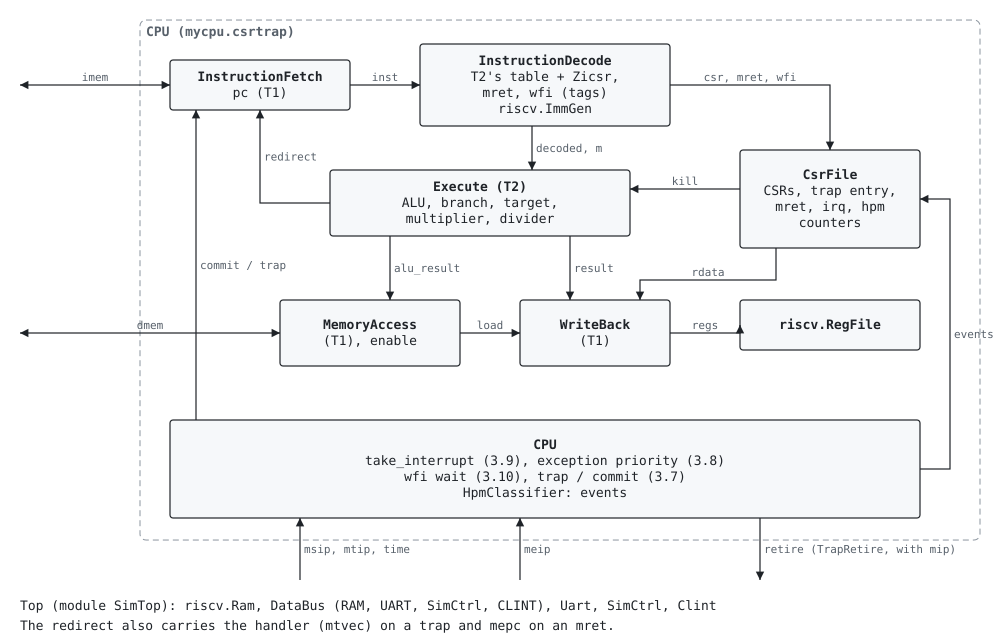

<!-- SPDX-License-Identifier: MIT -->
# T3: Zicsr, Machine-Mode Traps, Interrupts, Counters and the CLINT

The core of T2 learns to **trap**: every case in which T1 and T2 halted (a bad word, `ecall`,
`ebreak`, a misaligned or unmapped access, a fetch from nowhere) now enters a handler through
`mtvec`, and the core takes **interrupts** from the CLINT's timer and software interrupt and from
SimCtrl's external interrupt line. It gains the machine-mode CSRs, `mret` and `wfi`, and
**performance counters** whose events explain every cycle that does not retire an instruction.
It is the third of five tasks, and the first that runs the ACT4 compliance suite.

## Goals

After this task you can:

- extend the decode table with the instructions of Zicsr, `mret` and `wfi`, through the table's
  extension mechanism, without touching a row of T2;
- build the CSR file of an M-mode-only hart: the read and write rules of Zicsr, the three kinds of
  CSR that must not be mixed (read-only by address, WARL, driven by hardware), trap entry and
  return, and the interrupt request (`CsrFile`, exercises 3.1 to 3.6);
- make a trap **precise**: an instruction that traps, or that an interrupt precedes, leaves no
  register, no CSR, no store, no device access and no division behind;
- take an interrupt at any instruction boundary, also while the divider stalls (the division is
  abandoned and restarts after `mret`), and implement `wfi`;
- count cycles, retired instructions and eight hardware events, and explain `cycles - instret`
  exactly as a sum of events;
- write the golden model's rules of Zicsr, traps and counters from the specification, and check
  the hardware against it, against ACT4 (Sail) and against riscv-tests.

### Key Characteristics

- Execution model: T2's (one instruction per cycle; a division `DIV_LATENCY` = 34 or 66 cycles,
  1 for the special cases; a store to a full UART waits), plus: a trap takes one cycle in which
  nothing retires, and a `wfi` waits until an enabled interrupt is pending.
- Instruction set: RV32IM, Zicsr (6), `mret`, `wfi`, Zicntr and Zihpm (`mhpmcounter3..10` with
  `mhpmevent3..10`), Zifencei, M-mode only (`Sm1p13`, no S or U). `misa` reads RV32IM.
- Traps: illegal instruction, `ecall`, `ebreak`, instruction/load/store address misaligned,
  instruction/load/store access fault; interrupts MEI (11) > MSI (3) > MTI (7); `mtvec` direct and
  vectored. No halts any more: the core's `halted` output is always low.
- Devices: T2's (RAM, UART, SimCtrl) and the CLINT at `0x0200_0000` (`msip`, `mtimecmp`, `mtime`,
  each 32-bit half written alone), whose `mtime` is also the `time` CSR.
- Implementation: T1's stages and T2's execute stage (your own answers in them), this task's
  decode, CSR file, CLINT, cycle classifier and core.
- Verification: ChiselSim specs, ACT4 (101 tests), riscv-tests `rv32ui` and `rv32um` and this
  task's machine-mode tests `t3mi`, co-simulation against the golden model `mycpu.common.Iss` with
  `IssM` (T2) and `IssCsr` (this task), and rv32emu v1.3 for the user programs.

## Block Diagram



The diagram is drawn from [`doc/block-diagram.dg`](doc/block-diagram.dg) by `make diagrams` at the top
of the repository; `make check-diagrams` fails when the two differ.

## What This Task Adds

### Traps (T3-02)

| Cause | `mcause` | `mtval` | `mepc` |
|-------|----------|---------|--------|
| instruction address misaligned (a jump or taken branch to a target that is not a multiple of 4) | 0 | the target | the jump (no link written) |
| instruction access fault (a fetch from an address with nothing behind it) | 1 | the address | the address |
| illegal instruction (a word that is no instruction, a CSR that does not exist, a write to a read-only CSR) | 2 | the word | the instruction |
| breakpoint (`ebreak`) | 3 | the pc | the instruction |
| load / store address misaligned | 4 / 6 | the address | the instruction |
| load / store access fault (an unmapped address) | 5 / 7 | the address | the instruction |
| `ecall` from M-mode | 11 | 0 | the instruction |
| interrupt MSI / MTI / MEI | `0x8000_0003` / `_0007` / `_000b` | 0 | the instruction that has not executed |

When several causes hold, the Privileged spec's order decides (fetch, then decode, then the
target, then misaligned before access fault). In vectored mode only interrupts go to
`BASE + 4 x cause`. Reset: `mtvec` = `0x8000_0000` (direct), `mstatus.MIE` = 0, every writable
CSR 0, `mtimecmp` all ones.

### Interrupts and WFI (T3-03, T3-02)

An interrupt is taken when `mstatus.MIE`, its `mie` bit and its `mip` bit are all set, before the
instruction at the pc, in any cycle: also while that instruction waits for the divider (the
divider's `kill` abandons the division; after `mret` it starts again from the beginning) or for a
device. `wfi` does not wait if an enabled interrupt is pending; then the interrupt is taken before
it (MIE = 1, `mepc` = the WFI) or execution continues at pc + 4 (MIE = 0). Otherwise it waits, and
in the cycle that one becomes pending it retires, and an interrupt that is due follows in the next
cycle with `mepc` = pc + 4. Measured: the latency of an enabled interrupt is 0 cycles (see "Trap and interrupt latency" below),
and a trap costs one cycle in which nothing retires (`ecall` built for `rv32i_zicsr`: 5307 cycles,
5299 instructions, 8 traps).

### Counters (T3-04, `docs/hpm-events.md`)

`mcycle` counts every cycle, `minstret` every retired instruction (a trap is not one), each unless
inhibited in `mcountinhibit`. Event n on `mhpmcounter<n + 2>` (the C runtime's benchmark markers set
that up): 1 divider busy, 2 taken branch or jump, 3 trap taken, 4 to 7 (load-use stall, flush
bubble, I-side wait, D-side wait) read 0 in T3, 8 other. Every cycle without a retired instruction
is in exactly one of 1, 4, 5, 6, 7, 8, so `mcycle - minstret = hpm1 + hpm4 + hpm5 + hpm6 + hpm7 +
hpm8` exactly.

## Stages and Files

### Reused (with your own answers)

| Unit | From | Used as |
|------|------|---------|
| `InstructionFetch`, `MemoryAccess`, `WriteBack`, `CPU.retireRecord`, `DataBus`, `DecodedInst` | T1 | the stages, the base of the retire record, the address decode |
| `Execute` (with its multiplier and divider), `Decode` (the table), `IssM` | T2 | the execute stage (its new `kill` input), the table T3 extends, M in the golden model |

### This task (`mycpu.csrtrap`)

| File | What it is |
|------|------------|
| `CsrFile.scala` | the CSRs, trap entry and return, the interrupt request, the counters (3.1 to 3.6) |
| `Clint.scala` | `msip`, `mtimecmp`, `mtime` (3.7) |
| `HpmEvents.scala` | the events and the cycle classifier |
| `InstructionDecode.scala` | the decode stage: T2's table with Zicsr, `mret` and `wfi` appended as tagged rows |
| `CPU.scala` | the core: interrupts, exceptions, WFI, traps and commit (3.8 to 3.11) |
| `Top.scala` | the system (`SimTop`) and the model emitter (`divLatency`, `tickDivisor`, `mutant`) |
| `IssCsr.scala` | the golden model's rules of Zicsr, traps and counters (given) |
| `ClintModel.scala` | the golden model's CLINT (given) |
| `Probes.scala` | the `csr` probe group of the observation interface |

### The golden model

`mycpu.common.Iss` keeps the state, the decode, the CSR address table, the WARL rules and the
sampling of what the ISA does not determine; every rule that the exercises of this task hold
(which CSR instructions write, which are illegal, what they write, trap entry, `mret`, which
interrupt wins, when the counters count, the CLINT's timer) comes from `IssCsr` through
`IssConfig.machine`. The model of this task is `IssCsr.T3` = `IssCsr(IssM(IssConfig.T3))`. Like
T2's `IssM`, it is given, written from the specification and independently of your hardware: a
mistake of your CSR file, CLINT or core shows up as a mismatch instead of being repeated in its
model.

## CA26: Exercises

Eleven exercises, each marked `[CA26: Exercise 3.<n>]` in the source.

<!-- table: exercises 3 -->
| ID | Title | File | Blanks |
|----|-------|------|--------|
| 3.1 | Which CSR instructions write, and which are illegal | `CsrFile.scala` | 1 |
| 3.2 | The value a CSR instruction writes | `CsrFile.scala` | 1 |
| 3.3 | Trap entry and return | `CsrFile.scala` | 2 |
| 3.4 | The interrupt request | `CsrFile.scala` | 1 |
| 3.5 | Where a trap goes | `CsrFile.scala` | 1 |
| 3.6 | Counting, inhibiting and writing the counters | `CsrFile.scala` | 1 |
| 3.7 | The timer registers and the timer interrupt | `Clint.scala` | 1 |
| 3.8 | Traps and commit: what an instruction that traps leaves undone | `CPU.scala` | 1 |
| 3.9 | Which exception an instruction raises | `CPU.scala` | 1 |
| 3.10 | Taking an interrupt at an instruction boundary | `CPU.scala` | 1 |
| 3.11 | WFI: waiting for an interrupt | `CPU.scala` | 1 |
<!-- end table -->

### Workflow

A blank does not compile, and sbt compiles a task as a whole, so no spec of this task runs while
a blank of it, or of a task before it, is left. Fill them all; then run the specs in this order,
which follows the dependencies, so that the first failure points at its exercise:

1. 3.1 to 3.7: `sbt "csrTrap/testOnly mycpu.csrtrap.CsrSpec
   mycpu.csrtrap.TrapSpec mycpu.csrtrap.InterruptSpec mycpu.csrtrap.CounterSpec
   mycpu.csrtrap.ClintSpec mycpu.csrtrap.IssTrapSpec mycpu.csrtrap.IssEquivalenceSpec"`. The last
   one runs the CSR file and the CLINT in lockstep with the golden model.
2. 3.8 to 3.11: `sbt "csrTrap/testOnly mycpu.csrtrap.T3TrapSpec mycpu.csrtrap.T3InterruptSpec
   mycpu.csrtrap.WfiSpec mycpu.csrtrap.T3CounterSpec mycpu.csrtrap.PreciseTrapSpec"`.
3. `make test`, the programs, then `make act4`.

## Commands

Run these in `3-csr-trap/`.

```shell
make test                 # every ChiselSim spec (builds the C programs for rv32i_zicsr and rv32im_zicsr first)
make test SEEDS=50        # the same with 50 random programs instead of 500
make test-riscv-tests     # rv32ui, rv32um and t3mi only
make verilator            # emit SimTop.sv and build build/t3/Vsim
make sim ELF=../build/sw/mycpu/rv32im_zicsr/irqtrap.elf SIM_ARGS="+retire-log=irq.log"
make test-programs        # every user and privileged program against its expected output
make check-rv32emu        # the user programs on rv32emu v1.3 and on your core
make check-uart           # the uart program echoes its input
make cosim-programs       # every program, privileged ones included, against the golden model
make cosim-random         # the random programs alone against the golden model (SEEDS=<n>)
make obs PROG=irqtrap     # an observation bundle of a program, for the web views
make check-obs            # the acceptance set of the observation bundles (sim/obs.mk)
make bench                # the benchmarks with the hpm events -> ../build/bench/t3.csv
make act4                 # ACT4 on your model (tests/act4)
make lint
make indent
make clean
```

| Variable | Default | Meaning |
|----------|---------|---------|
| `ARCH` | `rv32im_zicsr` | the build of the C programs: `rv32im_zicsr` or `rv32i_zicsr` (libgcc) |
| `DIV_LATENCY` | 34 | the divider: 34 or 66 |
| `TICK_DIVISOR` | 1 | clock cycles per tick of the CLINT's `mtime` |
| `MUTANT` | empty | `sra`, `no-sign-fix`, `mtip-bit5`, `mret-no-mpie`, `no-illegal-csr`, `csr-always-writes` or `mtval-zero`: a model with a known bug |
| `BENCH_CONFIGS` | `34/rv32i_zicsr 34/rv32im_zicsr 66/rv32im_zicsr` | what `make bench` runs |
| `SEEDS`, `ELF`, `SIM_ARGS`, `MAX_CYCLES`, `UART_DIVIDER`, `RAM_BYTES`, `BOOTCAMP_DIR` | | as in T2 |

## Test Suite

`make test` runs 19 specs with 140 tests:

| Spec | Tests | What it checks |
|------|-------|----------------|
| `CsrSpec` | 18 | every CSR address, the read and write rules, WARL fields, `mcause` against Sail |
| `TrapSpec` | 7 | trap entry and return in the CSR file, every cause, both modes |
| `InterruptSpec` | 4 | all lines, enables and `MIE`, priority, wake |
| `CounterSpec` | 14 | counting, inhibiting, writing, every event on every counter, the classifier |
| `ClintSpec` | 11 | both halves, the safe `mtimecmp` sequence, MTIP, `msip`, the tick divisor |
| `IssEquivalenceSpec` | 2 | the CSR file and the CLINT in lockstep with the golden model, 40 + 20 random programs |
| `LeafLintSpec` | 5 | the leaf units pass `verilator --lint-only -Wall` |
| `IssTrapSpec` | 26 | the golden model's rules one by one (the model half of the exercises) |
| `IssCsrSpec` | 4 | `IssCsr` as a configuration, random programs with M and CSRs, the model's CLINT |
| `CoSim2ReplaySpec` | 11 | the replay of T3 records: interrupts, sampled counters, WFI, `EXIT` |
| `T3TrapSpec` | 10 | every exception of T3-02 on the core: `mepc`, `mcause`, `mtval`, nothing else changed |
| `T3InterruptSpec` | 4 | bit positions, the `MIE` gate, priority, vectored mode, levels |
| `WfiSpec` | 4 | WFI with and without `MIE`, due before it and arriving during it, event 8 |
| `T3CounterSpec` | 4 | `minstret`/`mcycle` N + 1, traps, `mret`, inhibit, writes, events 1 to 8 and the partition |
| `PreciseTrapSpec` | 2 | the timer interrupt moved over 71 cycles: no store, `PUTC` or division twice or lost; exceptions write nothing |
| `CoSimSpec` | 3 | the short C programs (with `ecall` and `irqtrap`), a build without M, 500 random programs with M and CSRs |
| `RiscvTestsSpec` | 1 | 40 `rv32ui`, 8 `rv32um` and 9 `t3mi` tests |
| `MutantSpec` | 9 | each mutant fails exactly its tests; the reference passes them |
| `CsrProbesSpec` | 1 | the `csr` probes of the observation interface through a timer interrupt, an `ecall` and their `mret`s: `mepc`, `mcause`, `mstatus`, `mie`, `mtvec` as the golden model has them in every cycle, the trap and access fields as each record says |

One more spec, `CsrMutantSpec` (5 tests: the two CSR-file mutants fail the directed checks and the
lockstep), is held back: it is not in your tree, and the TAs run it on your submission.

```shell
make test
# [info] Tests: succeeded 140, failed 0, canceled 0, ignored 0, pending 0
# [info] All tests passed.
```

## Expected Results

Measured on the reference implementation with Verilator 5.054 and xPack GCC 15.2.0 (`-O2`).
Simulation is cycle-exact, so your numbers must be **identical**.

### ACT4 (`make act4`)

```
  suite            expected      ran   passed
  ExceptionsSm            4        4        4
  I                      39       39       39
  InterruptsSm            7        7        7
  M                       8        8        8
  Sm                     28       28       28
  Zicntr                  2        2        2
  Zicsr                   6        6        6
  Zifencei                1        1        1
  Zihpm                   2        2        2
  Zmmul                   4        4        4
  PASS: 101 tests in 10 suites
```

Every mutant model fails it: `sra` 2 tests of `I` (`I-sra-00`, `I-srai-00`), `no-sign-fix` 2 of `M`
(`M-div-00`, `M-rem-00`), `mtip-bit5` 6 (5 of `InterruptsSm`, and `Sm_Zicntr-00`, which runs into the cycle limit), `mret-no-mpie` 1 of `Sm`
(`Sm_xret-00`).

### riscv-tests (`make test-riscv-tests`)

40 of 40 `rv32ui`, 8 of 8 `rv32um` and 9 of 9 `t3mi`. With `MUTANT=`: `sra` fails `lui`, `sra`,
`srai`; `no-sign-fix` fails `div`, `rem`; `mtip-bit5` fails `t3mi-mtip`, `t3mi-wfi`;
`mret-no-mpie` fails `t3mi-mret`, `t3mi-vectored`; the other three (`no-illegal-csr`, `csr-always-writes`, `mtval-zero`) are caught by a riscv-test or a `t3mi` program too. Each of the seven runs exits nonzero (`make list-mutants` names them).

### Programs (`make test-programs`, `make check-rv32emu`)

| Program | Class | Exit | `rv32im_zicsr` cycles | instret | `rv32i_zicsr` cycles | instret |
|---------|-------|------|-----------------------|---------|----------------------|---------|
| `add` | user | 0 | 573 | 573 | 573 | 573 |
| `lw` | user | 0 | 358 | 358 | 358 | 358 |
| `beq` | user | 0 | 214 | 214 | 214 | 214 |
| `fibonacci` | user | 0 | 2552643 | 2552643 | 2554446 | 2554446 |
| `quicksort` | user | 0 | 26153 | 25609 | 31240 | 31240 |
| `sb` | user | 0 | 14664 | 10040 | 22100 | 22100 |
| `strings` | user | 0 | 13605 | 8573 | 33627 | 33627 |
| `muldiv` | user | 0 | 176923 | 92357 | 578299 | 578299 |
| `jit` | user | 42 | 795 | 795 | 935 | 935 |
| `qrcode` | user | 0 | 3722192 | 3215286 | 5594280 | 5594280 |
| `dhrystone` | user | 0 | 276147 | 272951 | 282004 | 282004 |
| `duremark` | user | 0 | 945691 | 940863 | 1946880 | 1946880 |
| `ecall` | privileged | 0 | 4889 | 4745 | 5307 | 5299 |
| `irqtrap` | privileged | 0 | 35528 | 31550 | 76008 | 73050 |
| `perf` | privileged | 0 | 17028 | 12846 | 40917 | 40917 |

The 12 user programs print the same text as rv32emu v1.3; the privileged ones run on MyCPU only.

### Whole programs against the golden model (`make cosim-programs`)

```
PASS quicksort: 25609 records in 26153 cycles (544 without a record) agree with the golden model, exit 0
PASS sb: 10040 records in 14664 cycles (4624 without a record) agree with the golden model, exit 0
PASS strings: 8573 records in 13605 cycles (5032 without a record) agree with the golden model, exit 0
PASS muldiv: 92357 records in 176923 cycles (84566 without a record) agree with the golden model, exit 0
PASS qrcode: 3215286 records in 3722192 cycles (506906 without a record) agree with the golden model, exit 0
PASS dhrystone: 272951 records in 276147 cycles (3196 without a record) agree with the golden model, exit 0
PASS duremark: 940863 records in 945691 cycles (4828 without a record) agree with the golden model, exit 0
PASS ecall: 4753 records in 4889 cycles (136 without a record) agree with the golden model, exit 0
PASS perf: 12846 records in 17028 cycles (4182 without a record) agree with the golden model, exit 0
PASS irqtrap: 31558 records in 35528 cycles (3970 without a record) agree with the golden model, exit 0
PASS fibonacci: 2552643 records in 2552643 cycles (0 without a record) agree with the golden model, exit 0
PASS jit: 795 records in 795 cycles (0 without a record) agree with the golden model, exit 42
```

(A record is an instruction or a trap: `ecall` has 4753 records, 8 of them traps, and 4745
retired instructions.) `irqtrap`'s 8 timer interrupts are taken by the model from the `mip` of
the records alone.

### The UART (`make check-uart`)

```
PASS uart (console on the UART): 62 bytes echoed in order, cycles=16734 instret=16598
PASS uart (console on PUTC): 62 bytes echoed in order, cycles=11771 instret=11635
```

### Benchmarks (`make bench`)

`../build/bench/t3.csv`: the programs' own counts between their markers, and the counters over the
same region (`hpm_cycles`, `hpm_instret`, `hpm1` to `hpm8`; events 3 to 7 are 0 in every row):

<!-- table: bench t3 benchmark=dhrystone,duremark,qrcode-table-L,qrcode-table-H,qrcode-bitwise-H columns=cycles,instret,cpi,hpm_cycles,hpm_instret,hpm1,hpm2,hpm8 -->
| variant | arch | benchmark | cycles | instret | cpi | hpm_cycles | hpm_instret | hpm1 | hpm2 | hpm8 |
|---------|------|-----------|--------|---------|-----|------------|-------------|------|------|------|
| div34 | rv32i_zicsr | dhrystone | 244521 | 244520 | 1.000 | 244541 | 244541 | 0 | 43509 | 0 |
| div34 | rv32i_zicsr | duremark | 1909733 | 1909832 | 1.000 | 1909846 | 1909846 | 0 | 396716 | 0 |
| div34 | rv32i_zicsr | qrcode-table-L | 1071313 | 1071305 | 1.000 | 1071321 | 1071321 | 0 | 194121 | 0 |
| div34 | rv32i_zicsr | qrcode-table-H | 1881637 | 1881629 | 1.000 | 1881645 | 1881645 | 0 | 348306 | 0 |
| div34 | rv32i_zicsr | qrcode-bitwise-H | 1972510 | 1972502 | 1.000 | 1972518 | 1972518 | 0 | 361340 | 0 |
| div34 | rv32im_zicsr | dhrystone | 243021 | 243020 | 1.000 | 243041 | 243041 | 0 | 43509 | 0 |
| div34 | rv32im_zicsr | duremark | 921034 | 921133 | 1.000 | 921147 | 921147 | 0 | 142033 | 0 |
| div34 | rv32im_zicsr | qrcode-table-L | 722304 | 630122 | 1.146 | 722312 | 630138 | 92174 | 83410 | 0 |
| div34 | rv32im_zicsr | qrcode-table-H | 1200142 | 1023198 | 1.173 | 1200150 | 1023214 | 176936 | 134044 | 0 |
| div34 | rv32im_zicsr | qrcode-bitwise-H | 1291019 | 1114075 | 1.159 | 1291027 | 1114091 | 176936 | 147078 | 0 |
| div66 | rv32im_zicsr | dhrystone | 243021 | 243020 | 1.000 | 243041 | 243041 | 0 | 43509 | 0 |
| div66 | rv32im_zicsr | duremark | 921034 | 921133 | 1.000 | 921147 | 921147 | 0 | 142033 | 0 |
| div66 | rv32im_zicsr | qrcode-table-L | 809056 | 630122 | 1.284 | 809064 | 630138 | 178926 | 83410 | 0 |
| div66 | rv32im_zicsr | qrcode-table-H | 1366670 | 1023198 | 1.336 | 1366678 | 1023214 | 343464 | 134044 | 0 |
| div66 | rv32im_zicsr | qrcode-bitwise-H | 1457547 | 1114075 | 1.308 | 1457555 | 1114091 | 343464 | 147078 | 0 |
<!-- end table -->

Scores: Dhrystone 1163 / 1170 DMIPS/MHz x 1000, DureMark 10472 / 21714 DureMark/MHz x 1000
(`rv32i_zicsr` / `rv32im_zicsr`), the same as T2. The file has 30 rows (10 workloads x 3
configurations). **The identity is exact in every row**: `hpm_cycles - hpm_instret = hpm1 + hpm4
+ hpm5 + hpm6 + hpm7 + hpm8` (QR table L at 34: 722312 - 630138 = 92174 = hpm1), and
`bench-run.sh` fails a row for which it is not. The program's own `cycles` and `instret` are read
by two instructions at slightly different times, so their difference is off by a few cycles from
the counters', which the markers freeze in one instruction. Two runs of `make bench` give
byte-identical CSV files.

### Trap and interrupt latency

- An enabled interrupt (its `mie` bit and `mstatus.MIE` set) is taken in the cycle in which its `mip` bit is set
  (one that wakes a `wfi` follows in the next cycle): `mip` is a function of registers (the CLINT's `msip` and its timer
  comparison, SimCtrl `MEIP`), and the decision is made in every cycle, also during a divider stall. ACT4's `RVMODEL_INTERRUPT_LATENCY` (10) and
  `RVMODEL_TIMER_INT_SOON_DELAY` (1000) are bounds that the run above meets.
- A trap costs one cycle without a retired instruction: `ecall` built without M has 8 traps and
  5307 - 5299 = 8 such cycles; `perf` built with M has `mcycle - minstret` = 3552 - 1410 = 2142 =
  63 divisions x 34 cycles, all `divider busy`.
- A WFI that waits retires in the cycle its interrupt becomes pending, and the interrupt is taken
  in the next cycle (`WfiSpec`).

### Lint

`make lint` prints no warning; the only waivers are those of `sim/lint.vlt`.

## Agreement with Sail (`sail-m-only.json`)

ACT4 computes its expected values on Sail, so wherever the specification leaves a choice, these
units and the golden model make Sail's. `sail-m-only.json` is the part of a Sail 0.16 configuration
that turns the default RV32 model into this hart. It is an override file:

```
sail_riscv_sim --rv32 --config-override 3-csr-trap/sail-m-only.json --print-isa-string
rv32im_zicntr_zicsr_zifencei_zihpm_zvl32b_zvl64b_zvl128b_zvl256b
```

(the `zvl*` entries are an artifact of Sail's printer: `V.support_level` is `Disabled`). What it
sets, and what must go into the `sail.json` of the ACT4 DUT configurations (`tests/act4/`), together with
the memory regions of `link.ld`:

| Key | Value | Why |
|-----|-------|-----|
| `extensions.*.supported` | `false` for all but `M`, `Zicsr`, `Zicntr`, `Zihpm`, `Zifencei` | M-mode only, no A/F/D/C/S/U |
| `extensions.M.mutable_misa` | `false` | `misa` ignores writes |
| `extensions.V.support_level`, `extensions.Stateen.*` | `Disabled`, `false` | no vectors, no `mstateen` CSRs |
| `base.mstatus.fs_legal_states`, `vs_legal_states` | `ExtContext_Off` | `mstatus.FS` and `VS` read 0 (Sail requires it without F and S) |
| `base.writable_hpm_counters` | `0x0000_07F8` | `mhpmcounter3..10` exist, 11..31 read 0 |
| `base.hpmevent_width_bits` | `4` | `mhpmevent3..10` are 4-bit fields |
| `base.mcountinhibit.writable_bits` | `0x0000_07FD` | CY, IR, HPM3..10 |
| `memory.physaddr_bits`, `memory.pmp.count` | `32`, `0` | no Sv32, no PMP CSRs |
| `memory.misaligned.exceptions.load_store` | `AlignmentException` | misaligned loads and stores trap |
| `platform.event_selectors` | `[]` | Sail's own hpm events (fence, misaligned access) count nothing |

Checked by experiment, with assembly programs run on Sail under this configuration (2026-11-15):

- **CSR addresses.** A `csrr` of each of the 4096 addresses: exactly the 171 of
  `CsrFile.implemented` do not trap (`CsrSpec` holds the list as ranges).
- **Reset values and WARL rules.** Each writable CSR read after reset, after a write of all ones
  and after a write of 0: `mstatus` 0x1888/0x1800, `misa` 0x40001100, `mie` 0x888, `mepc`
  0xfffffffc, `mtval` and `mscratch` 32 bits, `mcountinhibit` 0x7fd, `mhpmevent3..10` 0xf,
  `mhpmcounter11..31[h]`, `mhpmevent11..31` and `mstatush` 0, `mip` not writable. A write of
  `mtvec` with MODE 2 or 3 writes BASE and keeps the mode.
- **`mcause`.** Every code from 0 to 69 and some wider values, without and with bit 31: Sail stores
  the exception codes 0 to 9, 11 to 13, 15 and 19 and the interrupt codes 1, 3, 5, 7, 9 and 11, and
  keeps the previous value on any other write (also through `csrrs` and `csrrc`). The sets are
  `mycpu.common.Trap.legalExceptions` and `legalInterrupts`, which the RTL and the model share.
- **`mhpmevent3..10`.** The values 0 to 15 read back; 0x1f and all ones read 0xf; 0x100 reads 0.
- **Traps.** `mcause`, `mepc` and `mtval` of an illegal instruction (the instruction bits), `ecall`
  (0), `ebreak` (the pc), misaligned and unmapped loads and stores (the address; misaligned
  outranks the access fault), a jump to a misaligned target (`mepc` the jump, `mtval` the target,
  no link written), an unimplemented CSR, a write to a read-only CSR, `csrrs`/`csrrsi` without a
  write; `mstatus` through trap entry and `mret`.
- **Interrupts.** MSI and MTI pending together with `mtvec` vectored: MSI first, at BASE + 12,
  then MTI at BASE + 28, `mepc` the instruction not executed, `mtval` 0; an exception in vectored
  mode goes to BASE.
- **`minstret` and `mcountinhibit`.** A write to `minstret` replaces the increment of its
  instruction; the instruction that writes `mcountinhibit` is counted by the old value.

What does not agree, and no configuration key changes it:

- **`mstatus` reads 0 after reset on Sail** (MPP 0) until the first write to it or the first trap;
  from then on MPP reads 3. This design reads 0x1800 from reset, the only legal value in an
  M-mode-only hart. A test that reads `mstatus` before writing it would differ.
- **The CLINT's `mtimecmp` resets to 0 on Sail**, so MTIP is pending from reset (`mip` reads 0x80).
  `platform.clint` has only `supported`, `base` and `size`. This design resets `mtimecmp` to all
  ones. A test that enables MTIE, or reads `mip`, before it writes `mtimecmp` would
  differ; the ACT4 runs have to confirm that no ACT4 test does.
- **`mcycle` and `time` follow Sail's platform clock** (`platform.instructions_per_tick`), not a
  cycle count: no value of them is comparable, only that they advance.
- **`mhpmcounter3..10` count this design's events** (`docs/hpm-events.md`); on Sail, with no
  event selector, they change only when written. A test that selects an event from 1 to 8 and
  then reads the counter differs, unless the counter is inhibited.

Not checked here: the external interrupt (Sail raises it from its own test device), the time a
WFI waits, and the device regions of `sail.json`; they belong to the ACT4 runs (`tests/act4/README.md`).

## What You Submit

One HackMD note for this task, in the format of the course handout's submission note, with:

1. **Test logs**, as the commands printed them: the summary lines of `make test`, and the output
   of `make test-riscv-tests` (and of the four `MUTANT` runs, which must fail), `make
   test-programs`, `make check-rv32emu`, `make cosim-programs` and `make check-uart`.
2. **The ACT4 summary**: `../build/act4/run/mycpu-t3/summary.log` from `make act4`.
3. **The benchmark report**: `../build/bench/t3.csv` from `make bench`.
4. **Your bootcamp answers**: `../build/bootcamp.patch` from `make bootcamp-patch` at the top of
   the repository.
5. **Two exercises explained**, at least, with **your own** waveform screenshots or `+retire-log`
   excerpts, walked through cycle by cycle. For example: the cycles around a timer interrupt that
   lands on a division (3.10), or a WFI's wait and wake-up (3.11).
6. **Answers to the three questions below.** Each needs a run with a parameter **you** choose:
   state the parameter, the command lines and the numbers you measured.

### Questions

The values in these questions are assigned to you: `make my-params` (at the top of the tree)
prints them from your student ID, which you write in the file `STUDENT_ID` (its letters in upper
case, or `NONE` if you audit the course; `scripts/student-id.py` says more). Use those values and
no others: the instructors repeat your runs with them. `<n>` below is your value.

**Predict first, and push the prediction.** Write the prediction of each question, with its
derivation, in `notes/t3-q<m>.md` of your fork (`notes/t3-q1.md` for Q1), commit it and push it
**before** the run, and put the measurement and the comparison in later commits without editing the
prediction. A run with a value of yours that is a make variable (`T3.Q2.TICK_DIVISOR`) does not
start until its question's prediction is committed and pushed: `make` names the file it waits for,
and the stamp of the run (`pred=` in a trace header or a bundle) names the commit of the
prediction. GitHub records when it received that commit; a prediction that reached it after the
measurement does not count.

**Q1. Where does the timer land?** Copy `software/programs/irqtrap` into a program of your own
(`software/programs/<name>/`, with a line `<name> privileged T3` in `software/programs/MANIFEST`;
`make -C ../software <name> ARCH=rv32im_zicsr` builds it), choose
its `PERIOD`, and put a division into the loop of `checksum` (`irqtrap` itself has none there, so
its interrupts never meet a division). Run it with `+retire-log`. For three of its interrupts,
give the cycle in which `mtime` reached `mtimecmp`, the record of the interrupt, and the
instruction it preceded. Find one that landed on a division in progress: how many cycles of that
division were lost, and how many cycles did the division take after the `mret`? Account for the
program's `cycles - instret` over its whole run, event by event (divisions, interrupted
divisions, WFI waits, the cycles of the traps).

**Q2. The tick divisor.** Before any run with it, predict `irqtrap`'s cycle count with your
`TICK_DIVISOR` from the default run's. Then build the model with your `TICK_DIVISOR`
(`T3.Q2.TICK_DIVISOR`; `make verilator TICK_DIVISOR=<n>`; every later `make sim` needs the same
`TICK_DIVISOR=<n>`) and run `irqtrap` and `perf`. Which lines of their output change, which do not,
and why? Explain the change of `irqtrap`'s cycle count from the number of ticks and the wait of its
two WFIs, and say why `make cosim-programs TICK_DIVISOR=<n>` still agrees with the golden model.

**Q3. Counters around your own code.** Write a short C function of your own (with at least one
division and one loop) and measure it as `perf` does: event n on `mhpmcounter<n + 2>`, frozen,
zeroed, released and frozen again. Report `mcycle`, `minstret` and the eight events, show that the
partition identity holds, and predict the count of event 2 from the disassembly (`*.dis`) before
you run it. Then move the final `csrw mcountinhibit` one instruction later, and explain what each
counter does with that instruction.

## File Organization

```
3-csr-trap/
├── Makefile
├── README.md
├── doc/block-diagram.dg     the block diagram's source (make diagrams draws the .svg)
├── sail-m-only.json                  the Sail override that makes Sail this hart
└── src/
    ├── main/scala/mycpu/csrtrap/
    │   ├── CsrFile.scala             Exercises 3.1 to 3.6
    │   ├── Clint.scala               Exercise 3.7
    │   ├── HpmEvents.scala           the events and the classifier
    │   ├── InstructionDecode.scala   T2's table with Zicsr, mret and wfi
    │   ├── CPU.scala                 Exercises 3.8 to 3.11
    │   ├── Probes.scala              the probes of the observation interface (docs/observation.md)
    │   ├── Top.scala                 the system (SimTop) and the model emitter
    │   ├── IssCsr.scala              the golden model's rules (given)
    │   └── ClintModel.scala          the golden model's CLINT (given)
    └── test/scala/mycpu/csrtrap/
        ├── T3.scala                  shared helpers: the golden model, the frame of a program
        ├── CsrBench.scala Checks.scala IssLockstep.scala CsrMutants.scala (and MutantEmit)
        ├── CsrSpec.scala TrapSpec.scala InterruptSpec.scala CounterSpec.scala ClintSpec.scala
        ├── IssEquivalenceSpec.scala LeafLintSpec.scala IssTrapSpec.scala IssCsrSpec.scala CoSim2ReplaySpec.scala
        ├── T3TrapSpec.scala T3InterruptSpec.scala WfiSpec.scala T3CounterSpec.scala PreciseTrapSpec.scala
        ├── CoSimSpec.scala RiscvTestsSpec.scala MutantSpec.scala CsrProbesSpec.scala
        └── RetireLogCheck.scala      the +retire-log checker
```

The programs of this task are `software/programs/{ecall,irqtrap,perf}`; the event IDs are in
`docs/hpm-events.md`; ACT4's configuration of this core is `tests/act4/cores/mycpu-t3`.

## References

- [The RISC-V Instruction Set Manual, Volume II: Privileged Architecture](https://riscv.org/specifications/ratified/),
  version 20240411: machine-level CSRs (§3.1), `mret` and `wfi` (§3.3), the timer (§3.2.1)
- Volume I: the "Zicsr", "Zicntr" and "Zihpm" chapters
- `2-rv32im/README.md`: the divider and its `kill`, the stages this task reuses
- `docs/hpm-events.md`: the events and the partition rule
