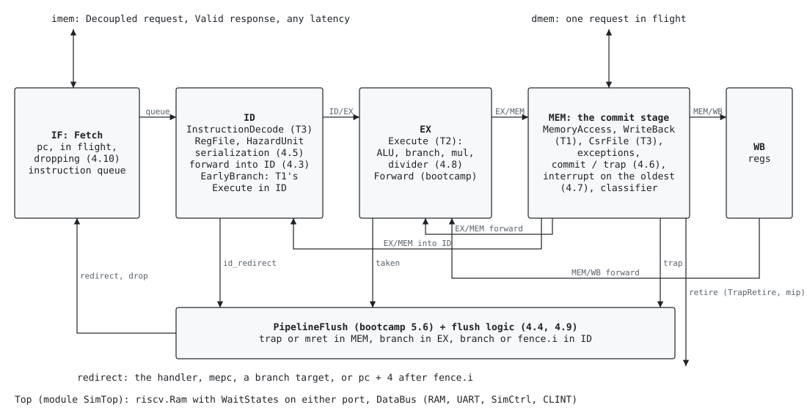

<!-- SPDX-License-Identifier: MIT -->
# T4: A Five-Stage Pipeline

The core of T3 is cut into **five stages** (IF, ID, EX, MEM, WB) that work on five instructions
at once. The instruction set, the traps, the CSRs, the counters and the devices stay exactly as in
T3; what changes is *when* things happen, and so what can go wrong: an instruction can need a
value that an older one has not written yet (a data hazard), a branch is decided after younger
instructions have already been fetched (a control hazard), and a trap must still look as if the
instructions ran one at a time. One source builds **three variants** of the hazard handling, and
the memories may answer **late**. It is the fourth of five tasks.

## Goals

After this task you can:

- build stage registers with an enable and a flush, and say what a bubble in each of them is for
  (`Stage`, exercise 4.1);
- derive, from the stage where each operand is produced and the stage where it is consumed, how
  many cycles an instruction must wait in each variant, and build the interlock that waits exactly
  that long (exercises 4.2 and 4.3);
- flush the wrong path after a taken branch, a trap, an `mret` or a `fence.i` (4.4, 4.9);
- keep traps **precise** in a pipeline: exceptions taken in program order in MEM, interrupts on the
  oldest instruction that has not committed, CSR instructions serialized, no side effect from an
  instruction that an older one cancels, and a division abandoned and restarted (4.5 to 4.8);
- fetch from a memory of any latency, with requests in flight that a redirect must not take back
  but whose responses it must drop (4.10);
- explain every cycle in which nothing commits, event by event, and so the CPI of each variant.

### Key Characteristics

- Pipeline: IF (a fetch unit with a queue), ID (decode, register read, hazard check,
  serialization; branches in `EarlyBranch`), EX (ALU, branches, multiplier, the iterative divider),
  MEM (data access, CSR access, traps: the **commit stage**), WB (register write).
- Variants (`VARIANT=`, `PipelineConfig.variant`):

  | Variant | Hazard handling | Branch resolved in |
  |---------|-----------------|--------------------|
  | `Stall` | interlock on every read-after-write hazard, no forwarding | EX |
  | `Forward` (default) | EX/MEM and MEM/WB forwarding into EX, 1-cycle load-use stall | EX |
  | `EarlyBranch` | `Forward`, plus branches and `jalr` resolved in ID with forwarding into ID | ID |

- Branch prediction: static not-taken. No BTB, no predictor.
- Memories: the instruction and data ports are `Decoupled` requests with `Valid` responses that may
  come any number of cycles later. `I_WAIT` and `D_WAIT` put wait states on the RAM's two ports
  (`0`, a fixed `<n>`, or `rand<max>:<seed>`).
- Instruction set, traps, CSRs, counters, devices: T3's (RV32IM_Zicsr_Zicntr_Zihpm_Zifencei,
  M-mode only), with T3's golden model.
- Verification: ChiselSim specs on every variant, ACT4 (101 tests), riscv-tests, co-simulation
  against the golden model (random programs, C programs, retire-log replay), rv32emu v1.3.

## Block Diagram



The diagram is drawn from [`doc/block-diagram.dg`](doc/block-diagram.dg) by `make diagrams` at the top
of the repository; `make check-diagrams` fails when the two differ.

## What This Task Adds

### Commit in MEM, and precise traps (T4-04)

An instruction **commits** in the cycle it leaves MEM without a trap: its retire record goes out
then, `minstret` counts it, a CSR instruction reads and writes its CSR then (the CSR file's
commit-cycle contract), and an `mret` returns then. WB only writes the register file; whatever is
in WB has committed.

- **Exceptions** are noted where they are found (a failed fetch in IF; an illegal word, `ecall`,
  `ebreak` in ID; a misaligned branch or jump target in EX, or in ID for `EarlyBranch`) and taken
  in MEM, together with MEM's own (a CSR access that is not allowed, a misaligned or faulting
  access), by T3's priority (exercise 3.10, called as `mycpu.csrtrap.CPU.exception`). MEM holds
  the oldest instruction, so exceptions are taken in program order; a trap flushes EX, ID and the
  fetch unit, and kills a division in EX.
- **Interrupts** are taken on the oldest instruction that has not committed: MEM's; if MEM holds a
  bubble, EX's (a division in progress is abandoned, and `mepc` is the division's pc); else ID's;
  else the next instruction the fetch unit will hand over. `mepc` is that pc. An instruction in
  MEM that has already presented its access to the data port, or a WFI that waits, has decided
  that no interrupt was due: the interrupt is taken after it, and its record shows the `mip` of
  its decision.
- **Side effects only from the oldest instruction.** The data port is used from MEM only, so a
  store or a load of a device register with a read side effect (UART `RXDATA`, `STATUS`) is never
  made for an instruction that an older one's trap cancels; a request on the port is held until
  it is accepted, and every accepted access completes: it commits, or takes its access fault.
- **Serialization.** Every CSR instruction (counters included), `mret`, `wfi` and `fence.i` waits
  in ID until EX and MEM are empty, and nothing younger leaves ID until it has committed. Two
  back-to-back `csrr minstret` read values exactly one apart on every variant.

### Hazards (T4-02): where operands are produced and consumed

| Value | Produced (ready at the end of) | Forwarded from |
|-------|--------------------------------|----------------|
| ALU, link, multiply, divide | EX | EX/MEM (instruction in MEM), MEM/WB |
| load data, CSR old value | MEM | MEM/WB only |
| any | WB writes the register file | write-through to ID in the same cycle |

| Consumer | Needs the operand in | `Stall` | `Forward` | `EarlyBranch` |
|----------|----------------------|---------|-----------|---------------|
| ALU, load/store address, store data, M | the cycle it leaves ID (`Stall`) / EX | ID | EX | EX |
| branch, `jalr` | as above | ID | EX | **ID** |

A consumer right behind its producer (distance 1) meets it one stage ahead; at distance 2, two
stages ahead. The stall is the number of cycles until the value can reach the stage where the
consumer needs it. For example, with `EarlyBranch` a branch in ID behind a load in EX waits while
the load is in EX (its value does not exist) and while it is in MEM (MEM's data cannot be
forwarded from EX/MEM), and takes it from MEM/WB: 2 cycles. `Stall` waits until the producer is in
WB, which writes the register file before ID reads it: 2 cycles at distance 1, 1 at distance 2.

Load-use stall cycles (hpm event 4) per sequence, as `HazardSpec` checks them exactly (the
producer writes `a1`, the consumer reads it). Four rows are yours to fill in: two to derive from
the tables above, two to read from the pipeline diagrams below. `HazardSpec` runs them without
checking their counts; the grading run checks them, so a guess that your core happens to match
is not enough: derive each count, then confirm it on your own core.

| Sequence | Example | `Stall` | `Forward` | `EarlyBranch` |
|----------|---------|---------|-----------|---------------|
| ALU-ALU | `add a1,t1,t1; add s0,a1,a1` | 2 | 0 | 0 |
| ALU, nop, ALU | | 1 | 0 | 0 |
| load-use | `lw a1,0(t2); add s0,a1,t1` | 2 | 1 | 1 |
| load, nop, use | | 1 | 0 | 0 |
| load-store (data) | `lw a1,0(t2); sw a1,4(t2)` | 2 | 1 | 1 |
| load-store (address) | `lw a1,8(t2); sw t1,4(a1)` | derive | derive | derive |
| ALU-store (data) | `add a1,t1,t1; sw a1,4(t2)` | derive | derive | derive |
| ALU-branch | `add a1,t1,t1; beq a1,zero,n` | 2 | 0 | 1 |
| ALU, nop, branch | | 1 | 0 | 0 |
| load-branch | `lw a1,0(t2); beq a1,zero,n` | 2 | 1 | 2 |
| load, nop, branch | | figure A | figure A | figure A |
| JALR after load | `lw a1,12(t2); jalr zero,0(a1)` | 2 | 1 | 2 |
| JALR after ALU | `addi a1,t3,0; jalr zero,0(a1)` | figure B | figure B | figure B |
| x0 destination | `add zero,t1,t1; add s0,zero,zero` (also a load to `x0`, a branch on `x0`) | 0 | 0 | 0 |

**Pipeline diagrams.** Each figure is the `hazards` program (`software/programs/hazards`) on the
reference core of each variant, drawn from its observation bundles (`make obs PROG=hazards
VARIANT=<variant>`): one row per instruction, one column per clock cycle, and in each cell the
stage that holds the instruction. A shaded cell is a cycle in which the instruction stays where
it was; a word waiting in the fetch queue is drawn in IF; a word that a redirect drops is marked
`(flushed)`. Read the stall cycles of the consumer, the instruction in the middle, from the cells
where it stays in ID while the instruction ahead of it moves on.

The first figure is a load-use pair (the third row of the table), to read against the table:


Figure A is a load, a nop, and a branch on the loaded register; figure B is an `addi` and a
`jalr` through the register it writes. Their stall counts are the table's rows marked "figure
A" and "figure B".


**Flush bubbles** (hpm event 5) per taken branch or jump: 2 where it is resolved in EX (`Stall`,
`Forward`: the instructions in ID and in IF), 1 in ID (`EarlyBranch`: the one in IF); a
not-taken branch costs nothing. With wait states, a data memory that answers late can keep a
load in MEM after its consumer would have left ID; the consumer then also waits in ID until the
load leaves MEM, so that it never reaches EX without its value (those cycles are D-side waits,
not load-use stalls).

### Memories of any latency (T4-06, T4-07)

The fetch unit asks for `pc`, `pc + 4`, ... one request per cycle while it has fewer than
`fetchDepth` (4) instructions requested and not yet handed to ID. Its `req.valid` depends on
registers only. A redirect cannot take back accepted requests: they stay counted, and their
responses are dropped as they arrive, while the queue is emptied at once. `fence.i` waits in ID
until every older instruction (so every older store, which commits only with its response) has
committed, then drops what the fetch unit holds or has requested and fetches from the pc after
it. The RAM's wait states (`WaitStates`) read the RAM on the instruction side when they accept a
fetch (so a fetch in flight while a store changes its word answers with the old word) and on the
data side when they answer (so a store takes effect late).

### Counters (T4-05, `docs/hpm-events.md`)

`minstret` counts committed instructions only (`instret` equals T3's for every benchmark, see
below). Each bubble carries the event it was made for, and is counted when it reaches MEM: divider
busy (1), load-use stall (4), flush bubble (5), I-side wait (6); a MEM that waits for its access is
a D-side wait (7); the pipeline filling, serialization, a waiting WFI and the cycle of a trap are
other (8). So `mcycle - minstret = hpm1 + hpm4 + hpm5 + hpm6 + hpm7 + hpm8` exactly.

## Stages and Files

### Reused (with your own answers)

| Unit | From | Used as |
|------|------|---------|
| `MemoryAccess`, `WriteBack`, `Execute` (branch decision), `DataBus`, `DecodedInst` | T1 | MEM's access and write-back value; the branch unit in ID (`EarlyBranch`); the data bus |
| `Execute` (ALU, multiplier, divider with `kill`), `Decode` | T2 | EX; the `fence.i` pattern |
| `InstructionDecode`, `CsrFile`, `HpmClassifier`, `Clint`, `CPU.exception` | T3 | ID's decode; the CSRs, traps and counters in MEM; the exception priority |
| `Forward`, `PipelineFlush`, `RegFile`, `Ram`, `Stage` (the idea) | bootcamp | forwarding into EX and ID; the stage flushes |

### This task (`mycpu.pipeline`)

| File | What it is |
|------|------------|
| `PipelineConfig.scala` | the variants, the configuration, the wait states (`WaitSpec`) |
| `Stage.scala` | the stage registers, with the event of a bubble (4.1) |
| `Hazard.scala` | the interlock of each variant (4.2) |
| `Fetch.scala` | the fetch unit for any latency (4.10) |
| `CPU.scala` | the pipeline: forwarding into ID (4.3), flushes (4.4), serialization (4.5), commit (4.6), interrupts (4.7), the divider (4.8), `fence.i` (4.9) |
| `WaitStates.scala` | wait states on a RAM port |
| `Probes.scala` | the `pipe` and `csr` probe groups of the observation interface |
| `Top.scala` | the system (`SimTop`) and the model emitter |

## CA26: Exercises

Ten exercises, each marked `[CA26: Exercise 4.<n>]` in the source.

<!-- table: exercises 4 -->
| ID | Title | File | Blanks |
|----|-------|------|--------|
| 4.1 | A stage register with enable and flush | `Stage.scala` | 1 |
| 4.2 | When an instruction must wait in ID | `Hazard.scala` | 1 |
| 4.3 | Forwarding into ID | `CPU.scala` | 1 |
| 4.4 | Flushes and redirects | `CPU.scala` | 1 |
| 4.5 | Serializing CSR instructions, mret, wfi and fence.i | `CPU.scala` | 1 |
| 4.6 | The commit stage: trap or commit | `CPU.scala` | 1 |
| 4.7 | Where an interrupt is taken | `CPU.scala` | 1 |
| 4.8 | The divider in the pipeline | `CPU.scala` | 1 |
| 4.9 | FENCE.I | `CPU.scala` | 1 |
| 4.10 | A fetch unit for a memory of any latency | `Fetch.scala` | 1 |
<!-- end table -->

### Workflow

A blank does not compile, and sbt compiles a task as a whole, so no spec of this task runs while
a blank of it, or of a task before it, is left. Fill them all; then run the specs in this order,
from the narrowest to the widest:

1. 4.1: `sbt "pipeline/testOnly mycpu.pipeline.StageSpec"`.
2. Programs: `make test-programs VARIANT=<v>` for each variant, then
   `sbt "pipeline/testOnly mycpu.pipeline.HazardSpec"` (the exact counts above). Every exercise
   takes part in these: the programs use CSRs, traps, interrupts, the divider and `fence.i`, and
   nothing commits without 4.6. A failure here points at 4.2 to 4.4 or 4.10 only when the specs of
   step 3 pass.
3. 4.5 to 4.9: `sbt "pipeline/testOnly mycpu.pipeline.PreciseTrapSpec mycpu.pipeline.CounterSpec
   mycpu.pipeline.LatencySpec"`.
4. `make test`, the programs, then `make act4` for each variant.

## Commands

Run these in `4-pipeline/`.

```shell
make test                          # every ChiselSim spec, on every variant
make test SEEDS=50                 # the same with 50 random programs per variant instead of 500
make test-riscv-tests VARIANT=Stall
make verilator VARIANT=EarlyBranch # emit SimTop.sv and build build/t4-earlybranch/Vsim
make sim ELF=../build/sw/mycpu/rv32im_zicsr/jit.elf SIM_ARGS="+retire-log=jit.log"
make test-programs                 # every user and privileged program against its expected output
make check-rv32emu                 # the user programs on rv32emu v1.3 and on your core
make check-uart                    # the uart program echoes its input
make cosim-programs                # every program against the golden model (retire-log replay, --stalls)
make test-programs I_WAIT=2 D_WAIT=rand3:7   # the same programs with wait states
make bench                         # every variant, both builds -> ../build/bench/t4.csv
make act4 VARIANT=Forward          # ACT4 on your model
make lint
```

| Variable | Default | Meaning |
|----------|---------|---------|
| `VARIANT` | `Forward` | `Stall`, `Forward` or `EarlyBranch` |
| `I_WAIT`, `D_WAIT` | 0 | wait states of the RAM's instruction / data port: `<n>` or `rand<max>:<seed>` |
| `ARCH` | `rv32im_zicsr` | `rv32im_zicsr` or `rv32i_zicsr` |
| `DIV_LATENCY` | 34 | the divider: 34 or 66 |
| `TICK_DIVISOR` | 1 | clock cycles per tick of the CLINT's `mtime` |
| `MUTANT` | empty | `sra`, `no-forward-mem` (not with `Stall`), `no-flush` (not with `EarlyBranch`), `mtip-bit5` |
| `BENCH_CONFIGS` | every variant with both builds | what `make bench` runs (`<variant>/<arch>`) |

Each combination of `VARIANT`, `DIV_LATENCY`, `I_WAIT`, `D_WAIT`, `TICK_DIVISOR` and `MUTANT` has a
model directory of its own (`build/t4-forward`, `build/t4-stall-i2-d1`, ...).

## Test Suite

`make test` runs 10 specs:

| Spec | What it checks |
|------|----------------|
| `StageSpec` | take, hold, flush (also with enable), the event of each bubble |
| `HazardSpec` | 21 sequences on each variant: those of the hazard table (its `x0` row as three: ALU, load, branch), taken forms of two of its branches, an independent pair, a taken branch and a `jal`; for each, stall and flush cycles from the retire port and from hpm events 4 and 5, exactly |
| `PreciseTrapSpec` | per variant: no trap from the shadow of a taken branch or jump; two exceptions in flight trap on the older, then the younger; no CSR write or `mret` younger than a trap takes effect; nothing written by a trapping instruction; the timer interrupt moved over 81 cycles of a stretch with a store, a `PUTC`, a division (killed, `mepc` the division, restarted from the beginning) |
| `CounterSpec` | per variant: two `csrr minstret` one apart, N + 1 around N; the partition identity, `minstret`, events 1, 2 and 3 exactly; a division's answer is kept while an older store waits; wait states counted as events 6 and 7 |
| `WaitStatesSpec` | the RAM wrapper: exact latency, order, data, one request per cycle |
| `LatencySpec` | 6 systems (each port with 0, 1, 2 and random wait states, all variants): a directed program whose branches, traps and `fence.i` happen with fetches in flight and a `fence.i` that waits for a late store (seen through a probe), `jit`, the short C programs and 40 random programs against the golden model |
| `CoSimSpec` | per variant: the short C programs (`jit`, `ecall`, `irqtrap` among them), one built without M, and 500 random programs with M and CSR instructions |
| `RiscvTestsSpec` | per variant: 40 `rv32ui`, 8 `rv32um` and 9 `t3mi` tests |
| `MutantSpec` | every mutant fails a riscv-test on the variants listed for it (`sra` and `mtip-bit5` on `Forward`, the other two on two variants each) |
| `PipeProbesSpec` | per variant: the `pipe` probes of the observation interface on the `hazards` program give `HazardSpec`'s stall and flush cycles for each of its 21 sequences; the `stall`, `flush` and `bubble` bits of ID, EX and MEM say what each stage holds next; IF, ID, EX and MEM show the program's words; MEM holds each instruction in the cycle of its record; the same on `Forward` with wait states on both ports |

## Expected Results

Measured on the reference implementation with Verilator 5.054 and xPack GCC 15.2.0 (`-O2`).
Simulation is cycle-exact, so your numbers must be **identical**.

### ACT4 (`make act4`)

All three variants pass every test:

```
  suite            expected      ran   passed
  ExceptionsSm            4        4        4
  I                      39       39       39
  InterruptsSm            7        7        7
  M                       8        8        8
  Sm                     28       28       28
  Zicntr                  2        2        2
  Zicsr                   6        6        6
  Zifencei                1        1        1
  Zihpm                   2        2        2
  Zmmul                   4        4        4
  PASS: 101 tests in 10 suites
```

T4 has T3's ISA, memory map and macros, so `tests/act4` maps `TASK=4` to the configuration of
`cores/mycpu-t3` (the same ELFs) and names the runs `build/act4/run/mycpu-t4-<model>/`. The
mutant models (Forward) fail it: `sra` 2 tests of `I`; `no-forward-mem` and `no-flush` all 101;
`mtip-bit5` 6 (5 of `InterruptsSm`, 1 of `Sm`).

### riscv-tests (`make test-riscv-tests`)

40 of 40 `rv32ui`, 8 of 8 `rv32um` and 9 of 9 `t3mi` on each variant. With `MUTANT=`: `sra` fails
3 `rv32ui` tests; `no-forward-mem` and `no-flush` fail every `rv32ui` and `rv32um` test (`no-flush`
on `Stall` too); `mtip-bit5` fails `t3mi-mtip` and `t3mi-wfi`. With `EarlyBranch`, the
`no-forward-mem` model stops at the first branch at an assertion: EX decides every branch again and
must agree with ID. Each of these runs exits nonzero.

### Programs (`make test-programs`, `rv32im_zicsr`)

| Program | instret | `Stall` cycles | `Forward` cycles | `EarlyBranch` cycles |
|---------|---------|----------------|------------------|----------------------|
| `add` | 573 | 1273 | 1046 | 913 |
| `lw` | 358 | 790 | 642 | 564 |
| `beq` | 214 | 455 | 377 | 329 |
| `fibonacci` | 2552643 | 3313496 | 2872588 | 2741384 |
| `quicksort` | 25609 | 44838 | 33717 | 31368 |
| `sb` | 10040 | 22088 | 18554 | 17482 |
| `strings` | 8573 | 20989 | 17118 | 16252 |
| `muldiv` | 92357 | 251356 | 210910 | 200319 |
| `jit` (exit 42) | 795 | 1499 | 1247 | 1129 |
| `ecall` | 4745 | 8492 | 6743 | 6481 |
| `irqtrap` | 31550 | 63222 | 43780 | 40247 |
| `hazards` | 504 | 894 | 699 | 650 |

(`qrcode`, `dhrystone`, `duremark` and `perf` print their own cycle counts, so their instruction
counts differ slightly between variants; the benchmark regions below do not.) The user programs
print the same text as rv32emu v1.3 on each variant (`make check-rv32emu`), and every program,
`irqtrap`'s timer interrupts included, agrees with the golden model record by record
(`make cosim-programs`), for both builds.

### Benchmarks (`make bench`, BEN-03, BEN-04)

[docs/performance.md](../docs/performance.md) explains the columns, why one run is enough and
how the CPI decomposes into the events.

`../build/bench/t4.csv` has 60 rows (10 workloads x 3 variants x 2 builds). `hpm_instret`
equals T3's for every row (T4-05): Dhrystone 243020 / 244520 instructions between the markers
(`rv32im_zicsr` / `rv32i_zicsr`), QR table L 630122 with M. **The identity is exact in every
row**: `hpm_cycles - hpm_instret = hpm1 + hpm4 + hpm5 + hpm6 + hpm7 + hpm8`, and
`bench-run.sh` fails a row for which it is not. Two runs give byte-identical files.

The rows of `rv32im_zicsr`, copied from the file, not written by hand. CPI decomposes
per instruction as `1 + (hpm1 + hpm4 + hpm5) / instret` plus the few dozen cycles of event 8 per
region; events 6 and 7 are 0 with the RAM as it is. For Dhrystone on `Stall`: 1 + 0.000 (divider)
+ 0.492 (load-use, hpm4) + 0.358 (flush, hpm5) = 1.850:

<!-- table: bench t4 arch=rv32im_zicsr benchmark=dhrystone,duremark,qrcode-table-L,qrcode-table-H columns=cycles,instret,cpi,score,hpm1,hpm2,hpm4,hpm5 -->
| variant | arch | benchmark | cycles | instret | cpi | score | hpm1 | hpm2 | hpm4 | hpm5 |
|---------|------|-----------|--------|---------|-----|-------|------|------|------|------|
| Stall | rv32im_zicsr | dhrystone | 449539 | 243020 | 1.850 | 633 | 0 | 43509 | 119500 | 87018 |
| Stall | rv32im_zicsr | duremark | 1610536 | 921133 | 1.748 | 12418 | 0 | 142033 | 405503 | 284066 |
| Stall | rv32im_zicsr | qrcode-table-L | 1279552 | 630122 | 2.031 | - | 92174 | 83410 | 390408 | 166820 |
| Stall | rv32im_zicsr | qrcode-table-H | 2110318 | 1023198 | 2.062 | - | 176936 | 134044 | 642068 | 268088 |
| Forward | rv32im_zicsr | dhrystone | 341539 | 243020 | 1.405 | 833 | 0 | 43509 | 11500 | 87018 |
| Forward | rv32im_zicsr | duremark | 1264259 | 921133 | 1.373 | 15819 | 0 | 142033 | 59183 | 284066 |
| Forward | rv32im_zicsr | qrcode-table-L | 932478 | 630122 | 1.480 | - | 92174 | 83410 | 43334 | 166820 |
| Forward | rv32im_zicsr | qrcode-table-H | 1537199 | 1023198 | 1.502 | - | 176936 | 134044 | 68949 | 268088 |
| EarlyBranch | rv32im_zicsr | dhrystone | 321538 | 243020 | 1.323 | 885 | 0 | 43509 | 35000 | 43509 |
| EarlyBranch | rv32im_zicsr | duremark | 1226074 | 921133 | 1.331 | 16312 | 0 | 142033 | 163009 | 142033 |
| EarlyBranch | rv32im_zicsr | qrcode-table-L | 912172 | 630122 | 1.448 | - | 92174 | 83410 | 106436 | 83410 |
| EarlyBranch | rv32im_zicsr | qrcode-table-H | 1508608 | 1023198 | 1.474 | - | 176936 | 134044 | 174400 | 134044 |
<!-- end table -->

Scores: Dhrystone 633 / 833 / 885 DMIPS/MHz x 1000 and DureMark 12418 / 15819 / 16312 DureMark/MHz
x 1000 (`Stall` / `Forward` / `EarlyBranch`, `rv32im_zicsr`); without M, Dhrystone 626 / 829 / 880
and DureMark 5621 / 7239 / 7592. The flush column is exactly 2 (resolved in EX) or 1 (in ID)
times hpm event 2 (Dhrystone: 43509 taken branches and jumps, 87018 and 43509 flush bubbles).
The divider column equals T3's (QR table L: 92174 cycles). `EarlyBranch` halves the flushes but
turns some branches behind an ALU instruction or a load into stalls, which is why its load-use
column is larger than `Forward`'s.

### Wait states (`I_WAIT=2 D_WAIT=2`, `Forward`)

The `perf` program (`software/programs/perf`, not one of the benchmarks), whose region it prints
itself (`make sim ELF=../build/sw/mycpu/rv32im_zicsr/perf.elf VARIANT=Forward I_WAIT=2 D_WAIT=2`):
`mcycle` 4385 (from 3875), `hpm6` 256 and `hpm7` 254 (from 0 and 0), the other events unchanged.
Where each of the two numbers comes from is part of question Q1.

### Lint

`make lint` prints no warning on each variant; the only waivers are those of `sim/lint.vlt`.

## What You Submit

One HackMD note for this task, in the format of the course handout's submission note, with:

1. **Test logs**, as the commands printed them: the summary lines of `make test`, and the output
   of `make test-riscv-tests` (and of the `MUTANT` runs, which must fail), `make test-programs`,
   `make check-rv32emu`, `make cosim-programs` and `make check-uart`, for each variant.
2. **The ACT4 summaries**: `../build/act4/run/mycpu-t4-<variant>/summary.log` from `make act4
   VARIANT=<variant>`, for each of the three variants.
3. **The benchmark report**: `../build/bench/t4.csv` from `make bench`.
4. **Your bootcamp answers**: `../build/bootcamp.patch` from `make bootcamp-patch` at the top of
   the repository.
5. **Two exercises explained**, at least, with **your own** waveform screenshots or `+retire-log`
   excerpts, walked through cycle by cycle. For example: the cycle in which a load-use stall is
   inserted (4.2), or the cycles around a timer interrupt that lands on a division (4.7, 4.8).
6. **Answers to the three questions below.** Each needs a run with a parameter **you** choose:
   state the parameter, the command lines and the numbers you measured.
   **Predict first.** For each question, commit your prediction and its derivation (a file
   `notes/q<n>.md` of your own, in your fork of this repository) **before** the run, then commit
   the measurement; the note shows both commits (`git log --format='%h %ad %s' -- notes/`), the
   prediction and the measurement side by side, and explains each difference. A prediction
   committed after its measurement does not count.

### Questions

**Q1. Wait states.** Give the RAM a number of wait states of your choice on each port, not the
`I_WAIT=2 D_WAIT=2` of the `perf` program above (`make bench-one I_WAIT=<i> D_WAIT=<d> VARIANT=<variant>
BENCH_OUT=../build/q1.csv`). Report the CPI change of Dhrystone against the table above and
explain it event by event: predict `hpm7` from the number of RAM data accesses and `hpm6` from the
number of redirects (`hpm2`) **before** you run it, then compare. Is the fetch unit's depth
(`fetchDepth`, 4 instructions) enough for your `I_WAIT` to fetch one instruction per cycle on
straight-line code? Derive the depth that a given `I_WAIT` needs from the cycles between a request
and its response (§T4.6 of the handout), and check your answer against `hpm6`.

**Q2. One hazard, three variants.** Pick a sequence of your own that is not in the hazard table
(two producers, or a producer three instructions before its consumer, or a store after a
multiplication), and put it in a loop of a program of your own (`software/programs/<name>/`, with
a line `<name> user T4` in `software/programs/MANIFEST`).
Derive its stall and flush cycles for each variant from the tables above, then check them with
`+retire-log` (the `idle` lines) on each model (`make sim VARIANT=<variant> ELF=...`), and show
the cycles of the stall in a waveform.

**Q3. Serialization.** Write a loop of your own that reads a counter with `csrr` in every
iteration. Predict its CPI on each variant, then measure it, explain the "other" cycles that each `csrr` costs, and
say what a younger instruction that reads the `csrr`'s result waits for, and why that is not a
load-use stall.

## File Organization

```
4-pipeline/
├── Makefile
├── README.md
├── doc/block-diagram.dg     the block diagram's source (make diagrams draws the .svg)
└── src/
    ├── main/scala/mycpu/pipeline/
    │   ├── PipelineConfig.scala      variants, configuration, wait states
    │   ├── Stage.scala               Exercise 4.1
    │   ├── Hazard.scala              Exercise 4.2
    │   ├── Fetch.scala               Exercise 4.10
    │   ├── CPU.scala                 Exercises 4.3 to 4.9
    │   ├── WaitStates.scala          wait states on a RAM port
    │   ├── Probes.scala              the probes of the observation interface (docs/observation.md)
    │   └── Top.scala                 the system (SimTop) and the model emitter
    └── test/scala/mycpu/pipeline/
        ├── T4.scala                  shared helpers, the probe top
        ├── StageSpec.scala HazardSpec.scala PreciseTrapSpec.scala CounterSpec.scala
        ├── WaitStatesSpec.scala LatencySpec.scala CoSimSpec.scala RiscvTestsSpec.scala MutantSpec.scala
        ├── PipeProbesSpec.scala
        └── Mutants.scala             the flush mutant, and MutantEmit
```

## References

- Patterson and Hennessy, *Computer Organization and Design, RISC-V Edition*, chapter 4 (the
  pipeline, hazards, forwarding, exceptions)
- The RISC-V Instruction Set Manual, Volume I ("Zifencei", "Zicsr") and Volume II (§3.1.15, the
  exception priority; §3.3.3, `wfi`)
- chisel-bootcamp Module 5: 5.6 (`PipelinedCore`, `Stage`, `PipelineFlush`), 5.7 (`Forward`,
  `ForwardingCore`)
- `3-csr-trap/README.md`: the CSRs, traps and counters this task keeps; `docs/hpm-events.md`
