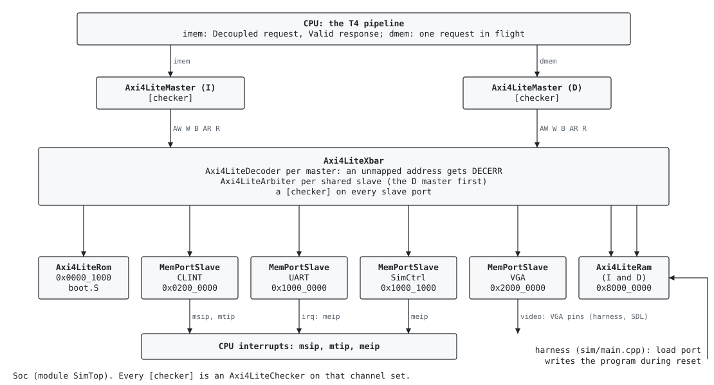

<!-- SPDX-License-Identifier: MIT -->
# T5: An AXI4-Lite System-on-Chip

Your T4 pipeline leaves its private memory and becomes the core of a **system-on-chip**. Its two
memory ports become **AXI4-Lite masters**, a **crossbar** routes their transactions to six
slaves at the addresses of the memory map (boot ROM, CLINT, UART, SimCtrl, VGA and a dual-ported
RAM), a **protocol checker** watches every interface, and the system **boots from ROM**. A VGA
shows nyancat and a QR code of this repository's URL, and a **shell** on the UART lets you poke
at the machine and run the benchmarks. The ISA, the traps and the counters are T3's and T4's; what
changes is that every access now crosses a bus with rules of its own. It is the last of five
tasks.

## Goals

After this task you can:

- explain the AXI4-Lite handshake: each `VALID` raised without waiting for `READY` and held,
  with a stable payload, until its own `READY`; AW and W independent; R after AR and B after both
  AW and W (exercises 5.1, 5.2);
- build a crossbar: decode an address to a slave, answer an address that no slave owns with
  `DECERR`, and arbitrate two masters on one slave without changing what a waiting slave sees
  (5.3, 5.4);
- read a synchronous memory (a block RAM) at one word per cycle (5.5), and check a bus with
  assertions (5.6);
- generate VGA timing, fetch pixels with the right pipeline alignment, and swap frame buffers at
  vertical blanking (5.7 to 5.9);
- follow the system from the reset vector in ROM to your program, and explain, event by event,
  why the same core runs the same program in more cycles behind a bus than in T4.

### Key Characteristics

- Core: T4's pipeline (`mycpu.pipeline.CPU`, your own answers, any variant), reset vector
  `0x0000_1000`.
- Bus: two `Axi4LiteMaster`s (instruction and data, one transaction outstanding each), the
  `Axi4LiteXbar` (no added latency, different slaves in parallel, the data master first on a
  shared slave), an `Axi4LiteChecker` on all 9 interfaces.
- Slaves: the boot ROM (`Axi4LiteRom`, the image of `boot/boot.S` built in at elaboration), the
  RAM (`Axi4LiteRam`, one port per master, synchronous read by default, optional wait states),
  and through `MemPortSlave` shells T3's CLINT, common's UART and SimCtrl, and the VGA (`Vga`).
- Interrupts: MSIP and MTIP from the CLINT; MEIP from SimCtrl `MEIP` or the UART's receive
  interrupt (`CTRL[0] && rx_valid`).
- Software: every program of T1 to T4 unchanged (they start at `0x8000_0000`, where the boot ROM
  jumps), the VGA programs (`vgatest`, `nyancat`, `qrcode-vga`) and the shell.
- Verification: ChiselSim specs from the unit level (each bus unit) to the whole SoC against the
  golden model from the boot ROM on, ACT4 (101 tests), riscv-tests, rv32emu v1.3, golden VGA
  frames and a QR decoder, and a scripted shell session.

## Block Diagram



The diagram is drawn from [`doc/block-diagram.dg`](doc/block-diagram.dg) by `make diagrams` at the top
of the repository; `make check-diagrams` fails when the two differ.

## What This Task Adds

### The memory map (D12)

| Base | Size | Slave | Notes |
|------|------|-------|-------|
| `0x0000_1000` | 4 KiB | boot ROM | the reset vector; a write is answered `SLVERR` (a store access fault) |
| `0x0200_0000` | 64 KiB | CLINT | `msip`, `mtimecmp`, `mtime` (SiFive layout, `3-csr-trap/README.md`) |
| `0x1000_0000` | 4 KiB | UART | `TXDATA`, `RXDATA`, `STATUS`, `CTRL` (`1-single-cycle/README.md`); RX interrupt |
| `0x1000_1000` | 4 KiB | SimCtrl | simulation only: `EXIT`, `PUTC`, counters, `MARK`, `MEIP` |
| `0x2000_0000` | 64 KiB | VGA | `ID`, `STATUS`, `CTRL`, `FRAME`, `SWAPS`, palette, two buffers (`mycpu.soc.Vga`) |
| `0x8000_0000` | 4 MiB | RAM | programs and data |

Any other address is answered `DECERR` by the crossbar, and the core takes an access fault: an
instruction (1), load (5) or store (7) access fault.

### Boot (T5-05)

`boot/boot.S` (assembled by `make -C ../software boot` into `build/sw/boot/boot.bin`, and built
into the ROM with `VecInit` at elaboration, no `$readmemh`) installs a trap vector of its own,
sets `a0` to `mhartid` and `a1` to 0, and jumps to `0x8000_0000`. A trap before the program
installs its own `mtvec` (the C runtime's `platform_init` does it first) ends the run with exit
code 63. Seven records of every run are the ROM's:

```
pc=00001000 inst=00000297  auipc t0, 0         pc=00001010 inst=00000593  li a1, 0
pc=00001004 inst=01c28293  addi t0, t0, 28     pc=00001014 inst=800002b7  lui t0, 0x80000
pc=00001008 inst=30529073  csrw mtvec, t0      pc=00001018 inst=00028067  jr t0
pc=0000100c inst=f1402573  csrr a0, mhartid
```

### The bus (T5-01 to T5-04)

- **Masters.** An `Axi4LiteMaster` takes the core's request in one cycle, keeps its own copy, and
  shows it on AR (a read, `wstrb` 0) or on AW and W (a write) until each channel's own `READY`.
  It has one transaction outstanding, and its `req.ready` is high again in the cycle the response
  arrives, so a read can follow a read without an idle cycle.
- **Crossbar.** Each master has a decoder; a slave that both masters reach has an arbiter, which
  keeps its grant while a slave waits with `VALID` high (5.3). The RAM has a port per master, so
  fetches and data accesses never wait for each other.
- **Slaves.** Every slave answers from registers (no combinational path from a request to its
  response). The RAM answers one cycle after the AR transfer, the next AR in that cycle: a word per
  cycle. A `MemPortSlave` device takes two cycles per access and each request exactly once.
- **Checker (T5-02).** `Axi4LiteChecker` asserts the five rules of its scaladoc on every
  interface. An assertion stops the Verilator model with exit code 3, so a program that runs to
  its end has broken no rule.

### What the bus costs: T5 against T4

The same Dhrystone build (`rv32im_zicsr`, 500 loops, `Forward`) counts the same 243041
instructions in its hpm region (the `hpm_*` columns of `make bench`, from `mhpmevent` set-up to
freeze; the `cycles` and `instret` columns, 243020 instructions, are the slightly shorter region
between the SimCtrl markers) on T4 and on T5, and the same 43509 taken branches and jumps (hpm
event 2). T4 runs it in 341587 cycles; T5 takes more, and how many more is question Q1.

The waveform below is the same stretch of the `hazards` program on the `Forward` core of each
task, drawn from the reference: a store, a load and a taken branch behind it (sequence
"load-branch (taken)" of T4's `HazardSpec`, in the order of the legend at the bottom). A column is
a clock cycle, numbered along the bottom of each panel; the two panels start in the same cycle of
the sequence, so a column of one is the same moment of the program as the column of the other,
until the first difference. A lane `IF pc` to `MEM pc` shows the address (its low 12 bits) of the
instruction in that stage, a flat shaded lane none; `MEM stall` and `IF flush` are the probes of
[docs/observation.md](../docs/observation.md), and the T5 panel adds the valid and ready lines of
the data master's five channels (a channel transfers in a cycle with both high). Read from it what
a store, a load and a redirect cost on T5 that they do not on T4, and which counter of the hpm
partition ([docs/performance.md](../docs/performance.md)) each extra cycle raises.


Straight-line fetch still runs at a word per cycle (`SocSpec` measures 128 instructions in 128
cycles). A device access goes through a `MemPortSlave` instead of the RAM (question Q3).

## Files

### Reused (with your own answers)

| Unit | From | Used as |
|------|------|---------|
| `CPU` (the pipeline), `PipelineConfig` | T4 | the core |
| `Clint`, `CsrFile` | T3 | the CLINT behind a shell; the CSR file inside the core |
| `Uart`, `SimCtrl`, `MemMap`, `SimTop` | common | devices behind shells; the memory map; the harness's ports |

### This task (`mycpu.soc`)

| File | What it is |
|------|------------|
| `Axi4Lite.scala` | the bundles and response codes |
| `Axi4LiteMaster.scala` | a core memory port as an AXI4-Lite master (5.1, 5.2) |
| `Axi4LiteXbar.scala` | the decoder (5.4), the arbiter (5.3), the crossbar |
| `Axi4LiteSlave.scala` | the read channel (5.5) and write channel of a memory slave, wait states |
| `Axi4LiteRam.scala`, `Axi4LiteRom.scala` | the RAM and the boot ROM |
| `MemPortSlave.scala` | a `MemPort` device on the bus |
| `Axi4LiteChecker.scala` | the protocol checker (5.6) |
| `Vga.scala` | the VGA: timing (5.7), pixel fetch (5.8), buffer swap (5.9) |
| `Soc.scala` | the SoC (`SimTop`) and the model emitter (`Emit`) |
| `boot/boot.S`, `boot/boot.ld` | the boot ROM |

## CA26: Exercises

Nine exercises, each marked `[CA26: Exercise 5.<n>]` in the source.

<!-- table: exercises 5 -->
| ID | Title | File | Blanks |
|----|-------|------|--------|
| 5.1 | The request channels: each VALID until its own READY | `Axi4LiteMaster.scala` | 1 |
| 5.2 | The response to the core | `Axi4LiteMaster.scala` | 2 |
| 5.3 | The grant | `Axi4LiteXbar.scala` | 2 |
| 5.4 | The way back, and an address that no slave owns | `Axi4LiteXbar.scala` | 2 |
| 5.5 | The word of a synchronous-read memory on the R channel | `Axi4LiteSlave.scala` | 1 |
| 5.6 | The checker's rule for a stable payload | `Axi4LiteChecker.scala` | 1 |
| 5.7 | Video timing: scan counters, visible area and sync pulses | `Vga.scala` | 1 |
| 5.8 | Pixel fetch: framebuffer address, x4 scaling and pipeline alignment | `Vga.scala` | 1 |
| 5.9 | Buffer swap at vblank | `Vga.scala` | 1 |
<!-- end table -->

### Workflow

A blank does not compile, and sbt compiles a task as a whole, so no spec of this task runs while
a blank of it, or of a task before it, is left. Fill them all; then run the specs in this order,
which follows the dependencies, so that the first failure points at its exercise:

1. 5.6 (the checker watches everything after it): `sbt "soc/testOnly mycpu.soc.AxiCheckerSpec"`.
2. 5.1, 5.2: `sbt "soc/testOnly mycpu.soc.Axi4LiteMasterSpec"`; 5.3, 5.4: `InterconnectSpec`; 5.5:
   `Axi4LiteRamSpec`, `Axi4LiteRomSpec`; then `SocBusSpec`, the bus without a core.
3. The SoC: `make verilator`, `make test-programs`, then `make test`.
4. 5.7 to 5.9: `make check-vga check-qr` (the golden frames say nothing of your code: compare a
   dumped frame with the golden one when they differ).
5. `make check-shell`, `make act4`, and `make demo` (with `SDL=1` to watch it).

## Commands

Run these in `5-soc/`.

```shell
make test                          # every ChiselSim spec (SEEDS=<n> random programs per system, default 20)
make test-riscv-tests VARIANT=Stall
make verilator VARIANT=EarlyBranch # boot ROM, SimTop.sv and build/t5-earlybranch/Vsim
make sim ELF=../build/sw/mycpu/rv32im_zicsr/fibonacci.elf SIM_ARGS="+retire-log=fib.log"
make test-programs                 # every user and privileged program against its expected output
make check-rv32emu                 # the user programs on rv32emu v1.3 and on your SoC
make check-uart                    # the uart program echoes its input
make cosim-programs                # every program, boot ROM included, against the golden model
make test-programs SYNC_READ=0 RAM_WAIT=rand3:7
make bench                         # every variant, both builds -> ../build/bench/t5.csv
make act4                          # ACT4 on your SoC
make check-vga check-qr            # golden frames, QR decode, and their mutants
make check-shell                   # the shell session over +uart-stdin
make demo                          # SDL=0: frames into ../build/t5-demo/ and checked; SDL=1: the window
make lint
```

| Variable | Default | Meaning |
|----------|---------|---------|
| `VARIANT` | `Forward` | T4's `Stall`, `Forward` or `EarlyBranch` |
| `SYNC_READ` | 1 | the RAM is read synchronously (1, a block RAM) or combinationally (0) |
| `RAM_WAIT` | 0 | wait states of every RAM response: `<n>` or `rand<max>:<seed>` (`max` 1, 3, 7 or 15) |
| `ARCH` | `rv32im_zicsr` | `rv32im_zicsr` or `rv32i_zicsr` |
| `DIV_LATENCY` | 34 | the divider: 34 or 66 |
| `TICK_DIVISOR` | 1 | clock cycles per tick of the CLINT's `mtime` |
| `MUTANT` | empty | `no-decerr` (the crossbar answers an unmapped address `OKAY`), `ram-wstrb-reversed` (the RAM applies byte strobes in reverse), `vga-no-id` (the VGA's ID reads 0), `uart-no-hold` (the UART loses a byte written while its transmit FIFO is full) or `sra` (T2's shifts) |
| `SDL`, `DEMO_HOLD` | 0, 1 (120 with `SDL=1`) | the demo's window, and the frames each QR picture stays |

Each combination of `VARIANT`, `DIV_LATENCY`, `SYNC_READ`, `RAM_WAIT`, `TICK_DIVISOR` and `MUTANT`
has a model directory of its own (`build/t5-forward`, `build/t5-stall-async-w2`, ...).

## The Shell (T5-08)

`software/programs/shell` reads lines from the UART and answers on the console (the UART itself
in the build with `CONSOLE_UART=1`, which `check-shell` and `demo` use; SimCtrl `PUTC` otherwise):

```
mycpu> help
  help                   this list
  peek <addr> [n]        n words from addr
  poke <addr> <value>    one word to addr
  csr [name]             one CSR, or all of them
  perf [reset]           mcycle, minstret, hpm events 1-8
  bench <name>           dhrystone, duremark or qrcode
  vga [frames]           nyancat on the VGA
  qr [style|all] [text]  a QR code on the VGA
  hold [frames]          frames each QR picture stays
  exit [code]            end the run
mycpu> peek 0x30000000
trap: mcause=0x00000005 mepc=0x800003a8 mtval=0x30000000
mycpu> qr dots sysprog21 rocks
style=dots ecc=M version=2 mask=1 scale=3
```

A trap in a command is reported and the prompt comes back. `bench` runs the benchmarks as they
are built alone (each prints its `perf: hpm` line and leaves the counters frozen with its region
for `perf`), `vga` runs nyancat, and `qr` draws the six styles of `qrcode-vga`. Run it yourself:

```shell
printf 'peek 0x20000000\nqr\nexit\n' | ../build/t5-forward/Vsim +elf=../build/sw/mycpu/rv32im_zicsr/shell.elf +uart-stdin
```

## Test Suite

`make test` runs 12 specs:

| Spec | What it checks |
|------|----------------|
| `AxiCheckerSpec` | each rule of the checker fires on a violation and on nothing else (5.6) |
| `Axi4LiteMasterSpec` | the master against slaves of every timing; the `drop-awvalid` mutant (5.1, 5.2) |
| `InterconnectSpec` | the crossbar: routing, `DECERR`, arbitration, the lock (5.3, 5.4); the `no-decerr` mutant |
| `Axi4LiteRamSpec`, `Axi4LiteRomSpec` | both read modes, a word per cycle, wait states, strobes, refused writes (5.5) |
| `MemPortSlaveSpec` | one request per transaction, back pressure, order, errors |
| `SocBusSpec` | the bus of the SoC without a core, under random traffic of two masters |
| `SocLintSpec` | each bus unit under `verilator --lint-only -Wall` |
| `BootSpec` | the ROM is the assembled `boot.S`; the boot records; exit 63 on an early trap; ROM loads and refused stores |
| `SocSpec` | per variant and per RAM (both read modes, fixed and random wait states): the short C programs and random programs from the boot ROM against the golden model; 128 straight-line instructions in 128 cycles; 9 checkers in the model; `DECERR` and its mutant |
| `RiscvTestsSpec` | per variant: 40 `rv32ui`, 8 `rv32um`, 9 `t3mi` and 4 `t5bus` tests |
| `BusProbeSpec` | the `bus` probes of the observation interface equal the data master's interface (where its checker sits) in every cycle, with and without RAM wait states; the AW, W and B of two stores and the AR and R of two loads (OKAY, DECERR) |

One more spec, `VgaSpec`, is held back: it restates exercises 5.7 and 5.8, so it is not in your
tree, and the TAs run it on your submission. You check the VGA with `make check-vga` and its golden
frames.

## Expected Results

The numbers below are those of the reference on Verilator 5.054.

### ACT4 (`make act4`)

```
  RESULT: All 101 tests passed.
  suite            expected      ran   passed
  ExceptionsSm            4        4        4
  I                      39       39       39
  InterruptsSm            7        7        7
  M                       8        8        8
  Sm                     28       28       28
  Zicntr                  2        2        2
  Zicsr                   6        6        6
  Zifencei                1        1        1
  Zihpm                   2        2        2
  Zmmul                   4        4        4
  PASS: 101 tests in 10 suites
```

T5 has T3's ISA and memory map, so `tests/act4` runs the ELFs of `cores/mycpu-t3` (`TASK=5`), each
through the boot ROM, and names the runs `build/act4/run/mycpu-t5-<model>/`.

### Programs (`make test-programs`, `rv32im_zicsr`, `Forward`)

| Program | cycles | instret |
|---------|--------|---------|
| `add` | 1466 | 580 |
| `lw` | 904 | 365 |
| `beq` | 527 | 221 |
| `fibonacci` | 3987500 | 2552650 |
| `quicksort` | 42871 | 25616 |
| `sb` | 23681 | 10047 |
| `strings` | 21200 | 8580 |
| `muldiv` | 252247 | 92364 |
| `jit` (exit 42) | 1728 | 802 |
| `ecall` | 9498 | 4752 |
| `irqtrap` | 49478 | 31557 |
| `hazards` | 908 | 511 |
| `perf` | 30577 | 13007 |

Each `instret` is T4's plus 7, the instructions of the boot ROM (T4: `fibonacci` 2552643
instructions in 2872588 cycles). SimCtrl takes the write to `EXIT` a cycle before the store
commits with its B response; the harness ends the run with the store's record (`sim/main.cpp`,
at most 8 cycles after the write), so the retire log has it. The user programs print the same
text as rv32emu v1.3 (`make check-rv32emu`), and every program, `irqtrap`'s timer interrupts and
`vgatest`'s VGA included, agrees with the golden model record by record from the boot ROM on
(`make cosim-programs`).

### Benchmarks (`make bench`, BEN-03, BEN-04)

[docs/performance.md](../docs/performance.md) explains the columns, why one run is enough and
how the CPI decomposes into the events.

`hpm_instret` equals T4's in every row; the identity `hpm_cycles - hpm_instret = hpm1 + hpm4 +
hpm5 + hpm6 + hpm7 + hpm8` holds exactly, and `bench-run.sh` fails a row for which it does not.

`../build/bench/t5.csv` has 60 rows (10 workloads x 3 variants x 2 builds). The rows below are
copied from it, not written by hand: the work (`instret`) and the taken branches and jumps (`hpm2`),
which are T4's. Its cycles, waits and CPI are not listed: question Q1 asks you to predict them from
T4's (Dhrystone CPI 1.850 / 1.405 / 1.323, DureMark 1.748 / 1.373 / 1.331, QR table L 2.031 /
1.480 / 1.448, `Stall` / `Forward` / `EarlyBranch`) before you measure them.

<!-- table: bench t5 arch=rv32im_zicsr benchmark=dhrystone,duremark,qrcode-table-L columns=instret,hpm2 -->
| variant | arch | benchmark | instret | hpm2 |
|---------|------|-----------|---------|------|
| Stall | rv32im_zicsr | dhrystone | 243020 | 43509 |
| Stall | rv32im_zicsr | duremark | 921133 | 142033 |
| Stall | rv32im_zicsr | qrcode-table-L | 630122 | 83410 |
| Forward | rv32im_zicsr | dhrystone | 243020 | 43509 |
| Forward | rv32im_zicsr | duremark | 921133 | 142033 |
| Forward | rv32im_zicsr | qrcode-table-L | 630122 | 83410 |
| EarlyBranch | rv32im_zicsr | dhrystone | 243020 | 43509 |
| EarlyBranch | rv32im_zicsr | duremark | 921133 | 142033 |
| EarlyBranch | rv32im_zicsr | qrcode-table-L | 630122 | 83410 |
<!-- end table -->

### VGA and QR (`make check-vga check-qr`)

`vgatest`, `nyancat` and the six QR styles equal the golden frames of `sim/tests/golden`
byte for byte (the same frames as on the T1 test top: frames are numbered by buffer swaps, so
the speed of the core does not matter), and every style decodes to exactly
`https://github.com/sysprog21/ca2026-mycpu`. The `VGA_SHIFT=1` model differs from every golden
frame, and the `QR_MUTANT=1` build decodes in no style.

### Shell and demo (`make check-shell`, `make demo`)

`check-shell` passes with both consoles (239 lines each, apart from `perf:` lines), and its frames
decode (`qr classic` to the URL, `qr logo sysprog21` to `sysprog21`) and equal the golden frames
(`qr classic`, nyancat's first frame). `make demo` runs about 79 million cycles: nyancat, all six
styles, a seventh picture of the text `MyCPU T5 on the VGA`, and the three benchmarks.

### Lint

`make lint` prints no warning; the only waivers are those of `sim/lint.vlt`.

## What You Submit

One HackMD note for this task, in the format of the course handout's submission note, with:

1. **Test logs**, as the commands printed them: the summary lines of `make test`, and the output
   of `make test-riscv-tests` (and of the `MUTANT` runs, which must fail), `make test-programs`,
   `make check-rv32emu`, `make cosim-programs` and `make check-vga check-qr check-shell`.
2. **The ACT4 summary**: `../build/act4/run/mycpu-t5-<variant>/summary.log` from `make act4`.
3. **The benchmark report**: `../build/bench/t5.csv` from `make bench`.
4. **Your bootcamp answers**: `../build/bootcamp.patch` from `make bootcamp-patch` at the top of
   the repository.
5. **Two exercises explained**, at least, with **your own** waveform screenshots or `+retire-log`
   excerpts, walked through cycle by cycle. For example: a write whose AW and W are taken in
   different cycles (5.1), or the cycle in which the VGA swaps its buffers (5.9).
6. **Answers to the three questions below.** Each needs a run with a parameter **you** choose:
   state the parameter, the command lines and the numbers you measured.
   **Predict first.** For each question, commit your prediction and its derivation (a file
   `notes/q<n>.md` of your own, in your fork of this repository) **before** the run, then commit
   the measurement; the note shows both commits (`git log --format='%h %ad %s' -- notes/`), the
   prediction and the measurement side by side, and explains each difference. A prediction
   committed after its measurement does not count.

### Questions

**Q1. The price of the bus.** Pick one benchmark and one variant. Predict, from T4's numbers of the
same build (`../build/bench/t4.csv`) and the waveform of "What the bus costs", its `hpm_cycles`
on T5 event by event (hpm events 6 and 7 above all), then run it and explain every difference
from your prediction, on your variant and on one other.

**Q2. Wait states.** Give the RAM a number of wait states of your choice (`RAM_WAIT=<n>`, or a
random one, `RAM_WAIT=rand<max>:<seed>`; for example `make bench-one RAM_WAIT=<n>
BENCH_OUT=../build/q2.csv`). Predict the CPI of one benchmark from the number of its fetches and
loads, then measure it, explain the change event by event,
and show in a waveform (`SIM_ARGS="+trace=<file>.fst +trace-start=<cycle>"`) one fetch and one
load with their AR, R and the cycles between.

**Q3. A device access.** Write a loop of your own that stores to a device register (`PUTC`, a VGA
palette entry) and one that stores to the RAM. Predict the cycles per store of each, then measure
them, explain the
difference from the `MemPortSlave` and the crossbar, and say which `VALID` and `READY` are high in
each cycle of one device store.

## File Organization

```
5-soc/
├── Makefile
├── README.md
├── doc/block-diagram.dg     the block diagram's source (make diagrams draws the .svg)
├── boot/
│   ├── boot.S                    the boot ROM (T5-05)
│   └── boot.ld
├── tests/shell/
│   ├── check-shell.sh            the shell session and the demo
│   ├── session.txt expected.txt  the session of check-shell and what it prints
│   └── demo.txt                  the session of the demo
└── src/
    ├── main/scala/mycpu/soc/      the bus units, the VGA and the SoC (see Files)
    └── test/scala/mycpu/soc/
        ├── T5.scala               the SoC and its golden model (boot ROM, VGA), RetireLogCheck
        ├── AxiBfm.scala Benches.scala                    bus functional models and benches
        ├── AxiCheckerSpec.scala Axi4LiteMasterSpec.scala InterconnectSpec.scala
        ├── Axi4LiteRamSpec.scala Axi4LiteRomSpec.scala MemPortSlaveSpec.scala SocBusSpec.scala SocLintSpec.scala
        ├── BootSpec.scala SocSpec.scala RiscvTestsSpec.scala BusProbeSpec.scala
        └── VgaTop.scala VgaTestTop.scala                  the T1 test top with the VGA (sim/vga.mk)
```

## References

- AMBA AXI and ACE Protocol Specification (ARM IHI 0022), Part B (AXI4-Lite) and §A3 (the
  handshake, the channel dependencies, the response codes)
- VESA Display Monitor Timing, 640 x 480 at 60 Hz
- ISO/IEC 18004 (QR code); `software/programs/qrcode-vga/README.md` (the styles)
- chisel-bootcamp: 2.3 (`Mux1H`), 2.4 (`RegNext`, `RegEnable`), 3.2_interlude (`Decoupled`), 5.8
  (`Bus`), 5.10 (synchronous memories and FPGAs)
- `4-pipeline/README.md`: the core and its counters; `docs/hpm-events.md`
